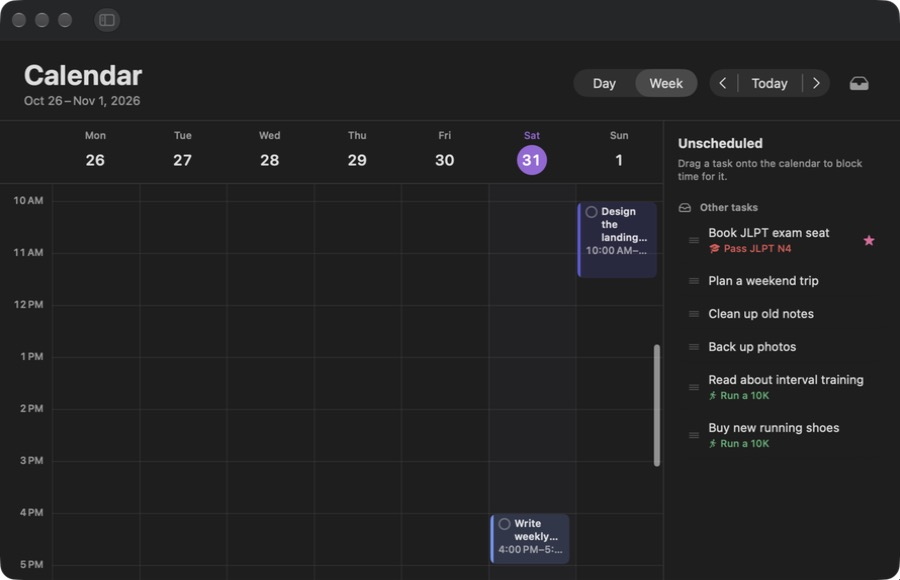

<h1 align="center">Horizon</h1>

<strong>A to-do app with an AI secretary that knows your day.</strong>

Your tasks, goals, habits, and Apple Calendar in one calm Mac app, plus a secretary that reads them, tells you what to do first, files what you jot down, and nudges you before things slip. It runs on <strong>your own</strong> Claude Code or Codex, with your own subscription.

  <a href="https://github.com/B0yangWong/Horizon-Releases/releases/download/v0.4.1/Horizon-0.4.1-macOS-universal.zip"><strong>Download for Mac</strong></a> |
  <a href="#meet-your-secretary">The secretary</a> |
  <a href="#set-it-up-in-two-minutes">Set up AI</a> |
  <a href="#the-planner-underneath">Planner features</a> |
  <a href="PRIVACY.md">Privacy</a> |
  <a href="README.zh-CN.md">中文说明</a>

A real answer from the secretary (Claude Code, Sonnet) about invented sample tasks.

---

## Meet Your Secretary

Most to-do apps hold your list. Horizon's secretary **reads it, together with your calendar, habits, and goals, and helps you act on it**.

| | What it does for you |
| --- | --- |
| **“What should I do first?”** | Ask in plain words. It answers from your actual tasks, deadlines, time blocks, streaks, and calendar, and suggests one clear order. Answers come as cards with buttons (add to My Day, set a reminder, move to a list, mark done) that change nothing until you click. You can send screenshots too. |
| **Understands each task** | **Look at this** in a task reads its notes, steps, and attachments (PDFs, images, links), then tells you how important it is and why, the real deadline and requirements with where it found them, the next step, and steps when the task needs a plan. |
| **Speaks up before things slip** | A morning brief, a reminder when something important is close, a question when a task looks stuck, a word of encouragement on a long streak. You set how often (never to up to 6 a day), quiet hours, and tone; it decides what's worth saying. If it said it would keep an eye on something, it reminds you. |
| **Files what you jot down** | Press ⌃⌥N anywhere and type, or hold ⌃⌥V and speak. It's saved as a task at once, then the secretary files it: a task with the right date and category, an item on a list, a new goal, or something to remember about you. Bring along the selected text, mail, or web page from the app you're in. |
| **Remembers and learns** | It keeps short memories about you (your term, your routine, how you like things) and builds on your “About me”. Thumbs up or down on any message; every three days it rewrites a short set of working rules from your feedback, which you can read and edit. |
| **Sorts the pile** | In All Tasks grouped by category, **Sort with Secretary** puts tasks into categories such as homework, exams, meetings, applications. |

**It suggests; you decide.** Nothing in your list changes without your click, except filing quick captures, which you can turn off.

## Set It Up in Two Minutes

Horizon has **no AI service of its own, no API keys, and no AI subscription to buy from us.** The secretary uses one of these tools, installed and signed in on your Mac by you:

| Tool | Account it uses | Install (in Terminal) | Sign in |
| --- | --- | --- | --- |
| [Claude Code](https://github.com/anthropics/claude-code) | A Claude plan that includes Claude Code | `brew install --cask claude-code` | `claude auth login` |
| [Codex](https://github.com/openai/codex) | A ChatGPT plan that includes Codex | `brew install --cask codex` | `codex login` |

Then click the person icon at the top right of Horizon (or open **Settings → Secretary**), choose **Turn On**, pick the tool and model, and click **Test**. Horizon shows whether each tool is installed and signed in. Requests count against your own plan's usage; Horizon never sees your sign-in. Turn on **Open Horizon at login** so the secretary can reach you without you opening the app first.

The secretary is **off until you turn it on**, and everything else in Horizon works without it.

**What leaves your Mac:** while the secretary is on, each request sends what that job needs to Anthropic (Claude Code) or OpenAI (Codex) through the tool you chose: the relevant tasks with their notes, steps, and attached text or pictures; your lists, goals, categories, and habits; your Apple Calendar events (if connected) from a year back to two years ahead; your “About me”; the secretary's memories; and recent chat messages. Their terms and privacy policies apply. Horizon runs the tool with its own tools, plug-ins (MCP servers), and saved sessions turned off. Turn the secretary off at any time and nothing more is sent. Details: [Privacy](PRIVACY.md).

**Already live in Claude Code or Codex?** Settings → Secretary → **Add to Claude Code / Add to Codex** lets those tools, when *you* use them in Terminal, look at your Horizon tasks and make the changes you ask for.

## The Planner Underneath

The secretary works on top of a complete, fast, native to-do app that is pleasant on its own.

| Feature | What you can do |
| --- | --- |
| My Day | Today's calendar events at the top in time order (foldable); below them, tasks you picked, tasks due or scheduled today, and timed habits. A countdown shows the next important deadlines, and suggestions bring back tasks that have gone quiet. |
| Goals | Long-term goals with optional short-term goals and deadlines; progress rolls up from tasks. Link tasks and habits to them. |
| Tasks | Steps, notes with pasted screenshots and files, due dates, importance, a list, a category, a calendar time block, repeats, and reminders. |
| Quick capture | ⌃⌥N in any app. “Tomorrow 3pm call Alex !”, “every mon and thu gym”, or “每周一三五晚上8点 跑步 @运动”: dates, times, repeats, importance, `#goal`, and `@list` are recognized as you type. |
| Voice capture | ⌃⌥V. Each shortcut can be a tap or a hold, so one key combination can do both: tap to type, hold to talk. |
| Review | What you finished this week or month, day by day, by category and goal, plus habit check-ins. |
| Lists and categories | Your own lists (Groceries, Homework…). Group All Tasks by due date or category and drag everything into your own order. |
| Habits | Daily, on certain weekdays, or N times a week, with streaks and an optional set time. |
| Calendar | Day, week, and month views; drag tasks onto the grid to schedule them. Two-way sync with a “Horizon” calendar in Apple Calendar (optional). |
| Search and Undo | ⌘F finds tasks, goals, habits, lists, and calendar events; ⌘Z takes back deletes, completions, moves, and check-ins. |
| Backups and updates | An automatic backup plus one copy for each of the last 7 days; JSON export. Signed in-app updates. |
| Comfort | English or Chinese, dates as words or dates, text size 85–150%, full keyboard navigation in task lists. |

More screenshots: task panel, search, goals, month calendar, habits, the secretary before it's turned on

All screenshots use invented, in-memory sample data with Apple Calendar turned off; they contain no personal data. The secretary chat is a real answer to that sample data. The task panel, search, goals, calendar, and habits screenshots come from 0.3.0 and look the same today.

## Install

**0.4.1 preview · macOS 15 or later · Universal (Apple silicon + Intel) · free for personal use.**

1. Download [Horizon-0.4.1-macOS-universal.zip](https://github.com/B0yangWong/Horizon-Releases/releases/download/v0.4.1/Horizon-0.4.1-macOS-universal.zip) from the [latest release](https://github.com/B0yangWong/Horizon-Releases/releases/latest). GitHub's “Source code” archives are documentation, not the app.
2. Unzip it and move `Horizon.app` into Applications (in-app updates need it there).
3. Open it. Horizon is ad-hoc signed, without Developer ID or Apple notarization, so macOS may block the first launch. If you trust the download, use only the manual exception in [Apple's instructions](https://support.apple.com/en-us/102445). If macOS says the app is damaged or will harm your computer, stop and report it. Do not disable system security checks.
4. Horizon asks once for notifications (reminders). Calendar, microphone, and reading other apps' selections are asked for only when you first use them. All optional.

**Updating:** from 0.4.0 on, click **Update to …** at the bottom of the sidebar. From 0.3.0 or earlier: quit, replace the app, open; your data is copied out of the old sandbox folder on first launch. Check downloads against `SHA256SUMS.txt` (it checks the file, not the publisher). The Apple silicon build has been checked on the development Mac; Intel Macs, older macOS, and a clean-Mac first install are untested. See [Installation](INSTALL.md) and [Validation](VALIDATION.md).

## Keyboard

| Action | Shortcut |
| --- | --- |
| Quick capture / voice capture from any app | `⌃⌥N` / `⌃⌥V` (changeable, tap or hold) |
| Add a task in the current list | `⌘N` |
| New goal / new list | `⇧⌘N` / `⇧⌘L` |
| Search, Undo, Redo | `⌘F`, `⌘Z`, `⇧⌘Z` |
| Back / Forward between lists | `⌘[` / `⌘]` |
| Sidebar lists in order | `⌘1` … `⌘8` |
| Selected task: complete / My Day / important / delete | `⌘D` / `⌘T` / `⌘I` / `⌘⌫` |
| In a task list | `↑` `↓` move, `⇧↑` `⇧↓` pick several, `Space` complete, `Return` open |
| Text size | `⌘+` / `⌘−` / `⌘0` |
| Close the task panel / the secretary | `Esc` or click empty space / click empty space |

## Your Data Stays on Your Mac

Tasks, goals, habits, attachments, the secretary's chat and memories, and backups are stored locally in `~/Library/Application Support/Horizon/`. There is no Horizon account, advertising, analytics, or cloud sync. Horizon itself only contacts GitHub, to check for updates once a day (switchable) and download one you choose. Data leaves your Mac only through features you turn on: the AI secretary (through your own tool, to Anthropic or OpenAI), Apple Calendar (synced by your calendar provider), and voice capture when your language can't be recognized on the Mac (Apple's speech service). See [Privacy](PRIVACY.md) and [Security](SECURITY.md).

## Limits and Feedback

Horizon is a preview for one Mac: no iPhone app, sync between Macs, Apple Reminders integration, or collaboration. The secretary can only write while Horizon is running, is only as good as the model you pick, and can be wrong. Date recognition follows simple rules and shows what it understood before adding.

For [bug reports and ideas](https://github.com/B0yangWong/Horizon-Releases/issues/new/choose), include your app version, macOS version, and steps using invented content. Issues are public: never attach real tasks, calendar details, chat transcripts, backups, or personal screenshots. See [Security](SECURITY.md) for vulnerabilities and [Changelog](CHANGELOG.md) for what's new.

## Terms

**Free for personal, non-commercial use only.** Selling Horizon, charging for it, redistributing it (including modified or renamed copies), or using it in any paid product or service is not permitted without written permission. The source code is private and no open-source license is granted. Full terms: [Usage Terms](USAGE.md).
