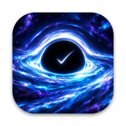
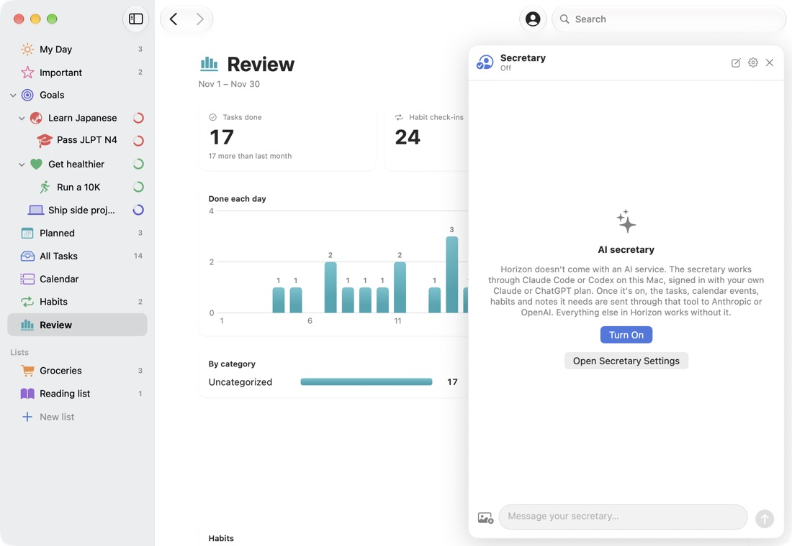
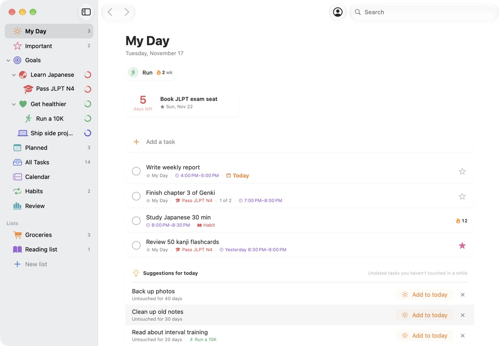
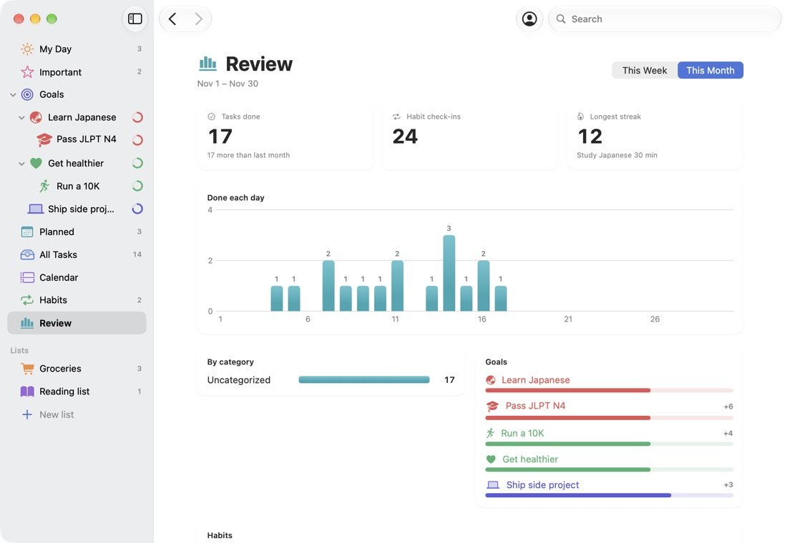
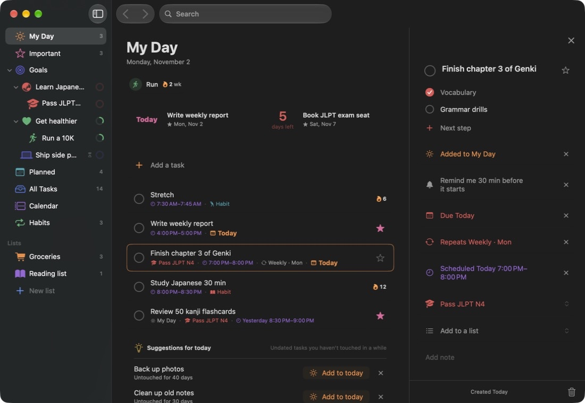
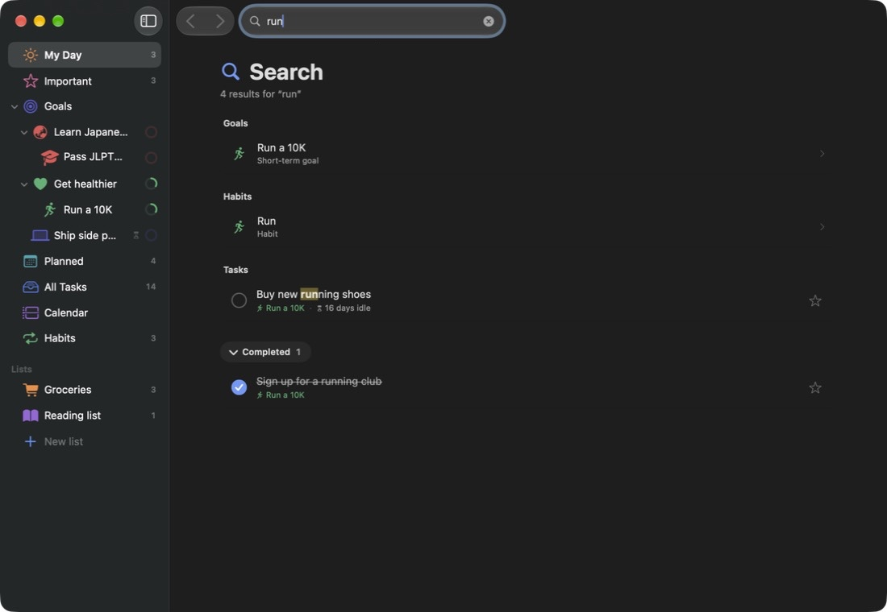
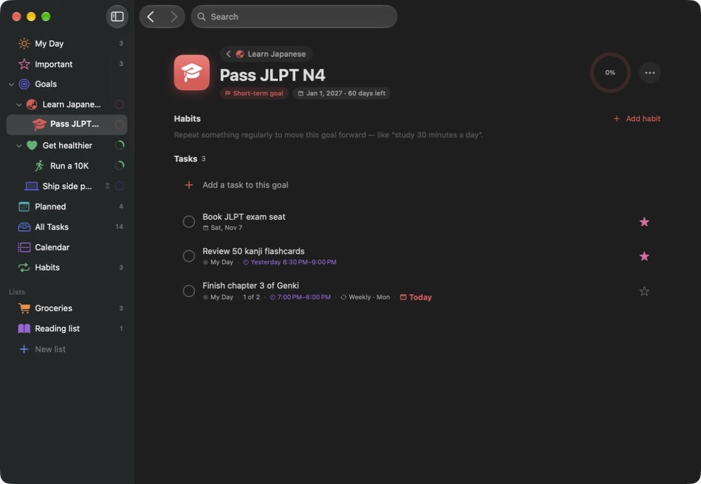
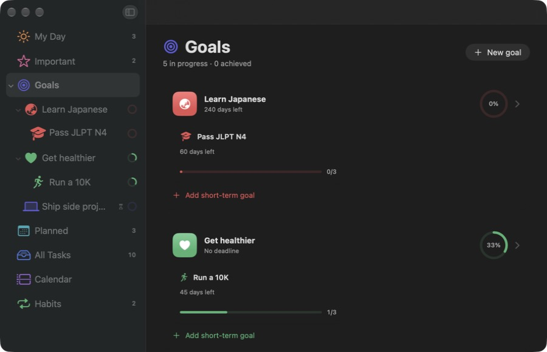
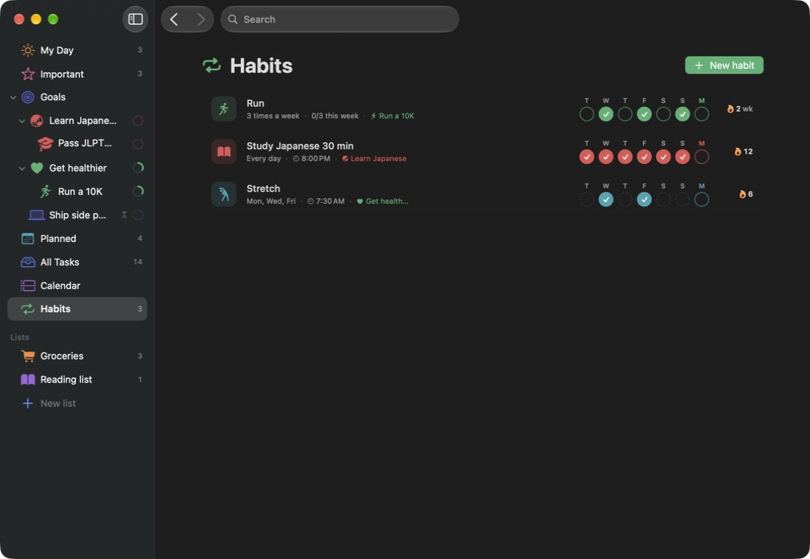
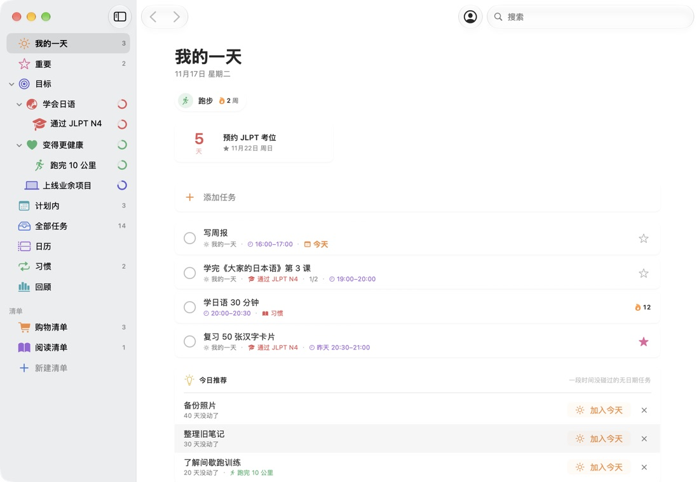

<h1 align="center">Horizon</h1>

<strong>A calm Mac planner for long-term goals, everyday tasks, and habits, with an optional AI secretary.</strong>

Break big goals into small steps, plan your day next to your Apple Calendar, and keep habits going.

  <a href="https://github.com/B0yangWong/Horizon-Releases/releases/download/v0.4.0/Horizon-0.4.0-macOS-universal.zip">Download for Mac</a> |
  <a href="#features">Features</a> |
  <a href="#ai-secretary-optional-bring-your-own-ai">AI secretary</a> |
  <a href="INSTALL.md">Installation</a> |
  <a href="PRIVACY.md">Privacy</a> |
  <a href="README.zh-CN.md">中文说明</a>

---

Set a long-term goal, add short-term goals underneath it if you like, and link tasks and habits to them. Keep everyday lists such as groceries or homework next to them. My Day brings today's calendar, tasks, timed habits, and a countdown to what's coming up into one place, and Review shows what you got done this week or month. Tasks can repeat, remind you, and be jotted down or spoken from any app with a keyboard shortcut; search finds anything, and Undo takes back a slip. Undated tasks don't disappear: Horizon gently points out what has gone quiet. There is no Horizon account, subscription, or cloud service.

If you want, an **AI secretary** can read your tasks, answer questions, write a morning brief, and file what you jot down. Horizon does not include an AI service: the secretary runs through **your own** Claude Code or Codex on your Mac, signed in with your own Claude or ChatGPT plan. It is **off until you turn it on**, and everything else works without it.

This repository hosts the downloadable app, documentation, and synthetic demo images. Application source code remains private. **Download the app ZIP in Releases; GitHub's automatically generated “Source code” archives contain this documentation, not the application.**

**0.4.0 preview · macOS 15 minimum build target · Universal (Apple silicon + Intel).** The Apple silicon build has been checked on the development Mac; Intel hardware, older macOS versions, and a separate clean-Mac first install have not been tested. The app is ad-hoc signed, without Developer ID signing or Apple notarization. macOS may block the first launch; read [Install and Open](INSTALL.md).

## Features

| Feature | What you can do |
| --- | --- |
| My Day | Today's calendar events sit at the top in time order (all-day first) and fold into one line. Below them: tasks you picked, tasks due or scheduled today, and timed habits in time order. Right-click an event to remove it from today. |
| Countdown | At the top of My Day: the next few important due dates, goal deadlines, and calendar events that look like exams or deadlines, within 30 days, with the days left. |
| Review | Tasks done this week or month compared with the one before, a bar for each day with its count, categories, goal progress, and habit check-ins. |
| Goals | Long-term goals with optional short-term goals inside them and optional deadlines. Progress rolls up from tasks and short-term goals; a goals overview shows everything, including achieved and archived goals. |
| Tasks | Steps, notes with pasted screenshots and attached files, a due date, importance, a goal, a list, a category, a time block on the calendar, and a reminder. Drag a task onto My Day, Important, Planned, a list, or a goal in the sidebar. |
| Lists and categories | Your own lists, such as “Groceries” or “Homework”, each with a color and icon. All Tasks can be grouped by due date or by category; drag categories and tasks into your own order, with a line showing where they'll land. |
| Repeating tasks | Daily, weekdays, weekly, monthly, yearly, or a custom rule such as every 2 weeks on Monday and Thursday. Completing one creates the next with its time and reminder. |
| Reminders | “Remind me” 10 or 30 minutes before a task starts, or at a time you pick. Optional automatic reminders before scheduled tasks, on the morning a task is due, and at habit times. |
| Quick capture | A global shortcut (⌃⌥N by default) opens a slim bar over any app. Type “Tomorrow 3pm call Alex !”, “every mon and thu gym”, or “每周一三五晚上8点 跑步 @运动” and Horizon fills in the date, time, repeat, importance, “#goal”, and “@list”. Optionally bring along the text selected in the app you're in, the selected mail in Mail or Outlook, or the page open in your browser. |
| Voice capture | A second shortcut (⌃⌥V by default) turns what you say into a task. Each shortcut can be set to a tap or a hold, so one key combination can do both: tap to type, hold to talk. |
| Search and Undo | ⌘F searches tasks (completed ones too), goals, habits, lists, and Apple Calendar events. ⌘Z takes back deletes, completions, date and list changes, calendar moves, and check-ins. |
| Habits | Every day, on certain weekdays, or a number of times per week, with a 7-day check-in strip, streaks, and an optional set time. |
| Calendar | Day, week, and month views. Drag tasks onto the grid to schedule them, or onto a day to make them due. Show or hide each calendar, grouped by account. |
| Apple Calendar sync | Scheduled tasks, tasks with a due date, and timed habits are written to a “Horizon” calendar; moving, renaming, or deleting them in Apple Calendar updates Horizon. “Import from Calendar” adds upcoming events as tasks. Optional. |
| Backup and updates | An automatic backup file plus one copy for each of the last 7 days, in a folder you can choose; JSON export and import. Horizon checks for new versions once a day (you can turn this off) and installs a signed update when you click. |
| Comfort | English or Simplified Chinese (switchable in Settings), dates as words (“in 2 days”) or as dates, text size from 85% to 150%, keyboard navigation in task lists, Back and Forward between lists, and a sidebar you can reorder. |

## AI Secretary (Optional, Bring Your Own AI)

Horizon has no AI service of its own and no API keys. The secretary uses one of these command-line tools, installed and signed in on your Mac **by you**:

| Tool | Account it uses | Install (in Terminal) | Sign in |
| --- | --- | --- | --- |
| [Claude Code](https://github.com/anthropics/claude-code) | A Claude plan that includes Claude Code | `brew install --cask claude-code` | `claude auth login` |
| [Codex](https://github.com/openai/codex) | A ChatGPT plan that includes Codex | `brew install --cask codex` | `codex login` |

Then open the secretary (the person icon in the toolbar) or **Settings → Secretary**, turn it on, and pick the tool and model. Horizon shows whether each tool is installed and signed in. Requests count against your own plan's usage limits; Horizon does not charge for them or see your sign-in.

What it does once on:

- **Chat:** ask about your tasks and schedule; answers come as cards with buttons (add to My Day, set a reminder, move to a list…) that change nothing until you click. You can paste pictures.
- **Task briefs:** “Look at this” in a task reads its notes and attachments and suggests importance, deadlines, a next step, and steps when needed.
- **Speaks up on its own, within your limits:** a morning brief, reminders about what's coming up, and the occasional question. Settings set how often (never to up to 6 a day), quiet hours, and tone.
- **Files quick captures:** what you jot down is saved as a task right away, then the secretary may file it as a list item, a goal, or a memory instead.
- **Learns from you:** thumbs up or down under each message; every three days it rewrites a short list of working rules you can see and edit.

**What leaves your Mac:** while the secretary is on, each request sends what that job needs to Anthropic (Claude Code) or OpenAI (Codex) through the tool you chose: the relevant tasks with their notes, steps, and attached text or pictures; your lists, goals, categories, and habits; your Apple Calendar events (if connected) from a year back to two years ahead; the “About me” text you write; the secretary's memories; and recent chat messages. Their own terms and privacy policies apply to that data. Horizon runs the tool with its own tools, plug-ins (MCP servers), and saved sessions turned off. Turn the secretary off at any time and nothing more is sent. See [Privacy](PRIVACY.md).

Optionally, **Settings → Secretary → Use Horizon in Claude and Codex** adds Horizon to your own Claude Code or Codex, so that when *you* chat with them in Terminal they can look at your tasks and make the changes you ask for.

## Preview

Screenshots use in-memory, invented sample goals, tasks, and habits, with Apple Calendar turned off. They contain no personal data, and the example content is not included in a fresh installation. My Day, Review, the secretary panel, and the Chinese screenshot come from the 0.4.0 build; the rest from 0.3.0, which looks the same in those views.

Task panel, search, goals, month calendar, habits, and Chinese interface

## Install and Open

1. Download [Horizon-0.4.0-macOS-universal.zip](https://github.com/B0yangWong/Horizon-Releases/releases/download/v0.4.0/Horizon-0.4.0-macOS-universal.zip) from the [0.4.0 release](https://github.com/B0yangWong/Horizon-Releases/releases/tag/v0.4.0).
2. Unzip it and move `Horizon.app` into Applications. In-app updates need it there.
3. Open the app. If macOS blocks an unverified developer, review the download and decide whether to trust it. Use only the manual exception described in [Apple's instructions](https://support.apple.com/en-us/102445). If the warning says the app will harm your computer or is damaged, stop and report it. Do not disable system security checks or run a quarantine-removal command.
4. Horizon asks once whether it may send notifications (for reminders). Apple Calendar, the microphone and speech recognition, and reading other apps' selections are asked for only when you first use them. All are optional.

**Updating from 0.3.0 or earlier:** quit Horizon, replace the app in Applications, and open it. On first launch 0.4.0 copies your data out of the old sandbox folder and leaves that folder untouched as a backup. From 0.4.0 on, click **Update to …** at the bottom of the sidebar, or **Install … and Reopen** in Settings → General, and Horizon updates itself.

`SHA256SUMS.txt` accompanies the release for checking download integrity. It does not verify publisher identity or imply Apple approval. See [Installation and Compatibility](INSTALL.md) for details.

## Everyday Controls

| Action | Shortcut |
| --- | --- |
| Quick capture from any app | `Control + Option + N` (changeable, tap or hold) |
| Voice capture from any app | `Control + Option + V` (changeable, tap or hold) |
| Jump to “Add a task” in the current list | `Command + N` |
| New goal / new list | `Command + Shift + N` / `Command + Shift + L` |
| Search | `Command + F` |
| Undo / Redo | `Command + Z` / `Command + Shift + Z` |
| Back / Forward between lists | `Command + [` / `Command + ]` |
| Sidebar lists, in their current order | `Command + 1` … `Command + 8` |
| Complete / My Day / Important for the selected task | `Command + D` / `Command + T` / `Command + I` |
| Delete the selected task | `Command + Delete` |
| Bigger / smaller / default text | `Command + +` / `Command + −` / `Command + 0` |
| Close the task panel | `Escape`, or click empty space |
| Close the secretary | Click empty space, or its close button |
| Settings | `Command + Comma` |

When adding a task, dates (“tomorrow”, “周五”, “this weekend”, “11/20”), times (“3pm”, “下午3点”), lengths (“1h”, “半小时”), repeats (“every mon and wed”, “每周一三五”, “工作日”), `!` for important, `#` plus part of a goal's name, and `@` plus part of a list's name are recognized and shown as chips before you press Return.

## Your Data Stays on Your Mac

Goals, tasks, lists, habits, attachments, the secretary's chat and memories, and backups are stored locally in `~/Library/Application Support/Horizon/`, and settings in `~/Library/Preferences/app.horizon.mac.plist`. There is no Horizon account, advertising, analytics, or cloud sync. Horizon itself connects to the internet only to check GitHub for updates once a day (switchable) and to download an update you choose to install. Data leaves your Mac only through features you turn on: the AI secretary (to Anthropic or OpenAI, through your own tool), Apple Calendar (synced by Apple or your calendar provider like any calendar), and voice capture when your language can't be recognized on the Mac (Apple's speech service). See [Privacy](PRIVACY.md).

## Current Limits and Feedback

Horizon is a preview for local Mac use. It does not include an iPhone app, sync between Macs, Apple Reminders integration, or collaboration. The secretary needs Horizon running to write to you (“Open Horizon at login” helps), can only be as good as the model you pick, and can be wrong: it suggests, and changes nothing without a click, except filing quick captures when that option is on. Date recognition follows simple rules and can misread unusual phrasing, which is why it is shown before adding. See [Validation](VALIDATION.md) for what has and has not been checked.

For [bug reports and feature requests](https://github.com/B0yangWong/Horizon-Releases/issues/new/choose), include your app version, macOS version, and steps using invented content. Issues are public: do not attach real task lists, calendar details, backup files, chat transcripts, or screenshots showing personal information. Read [Security](SECURITY.md) before reporting a vulnerability.

The app is free to download and run on your own Mac. This repository does not grant an open-source license to the application or icon. See [Usage](USAGE.md) and [Changelog](CHANGELOG.md).
