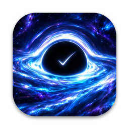
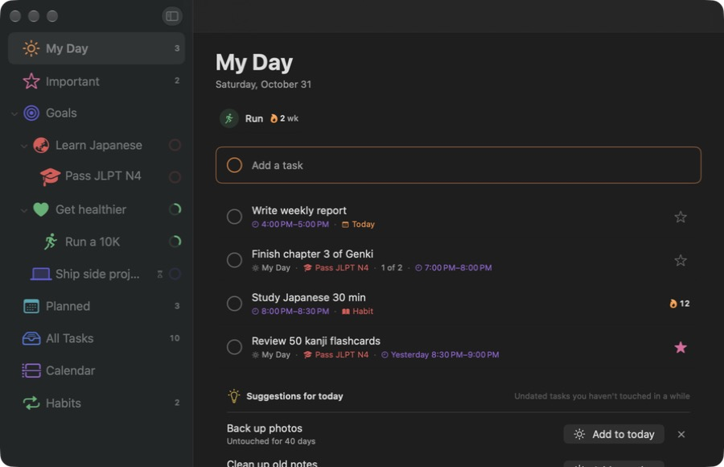
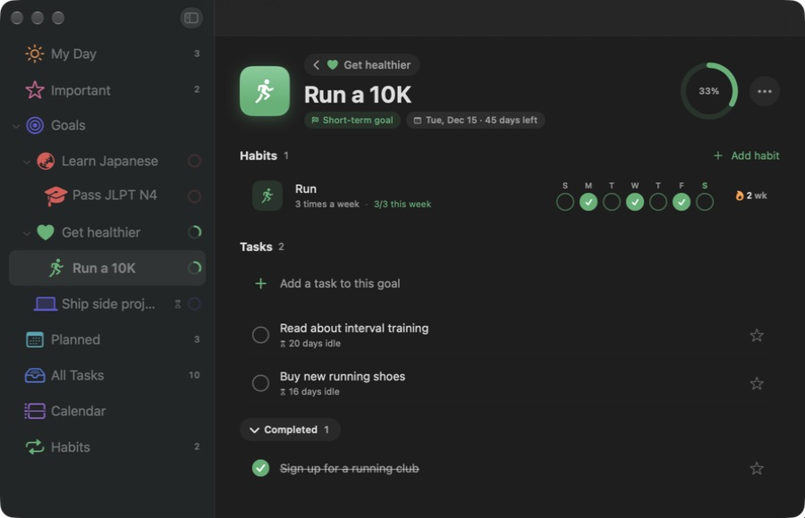
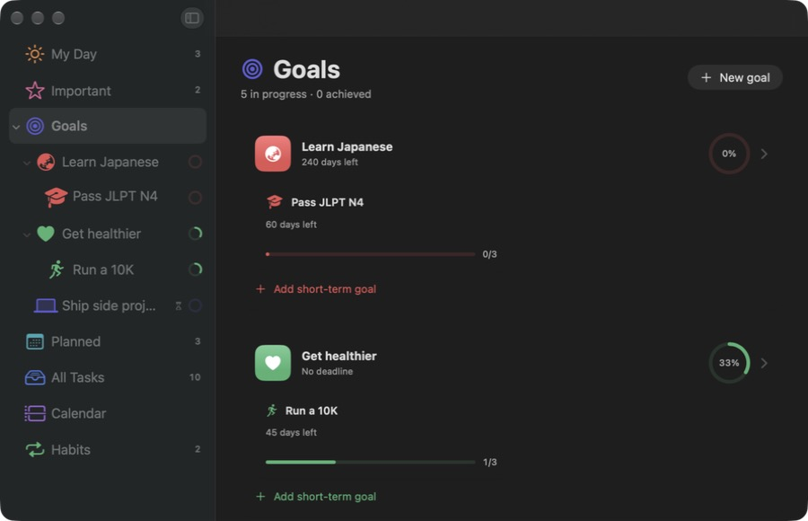
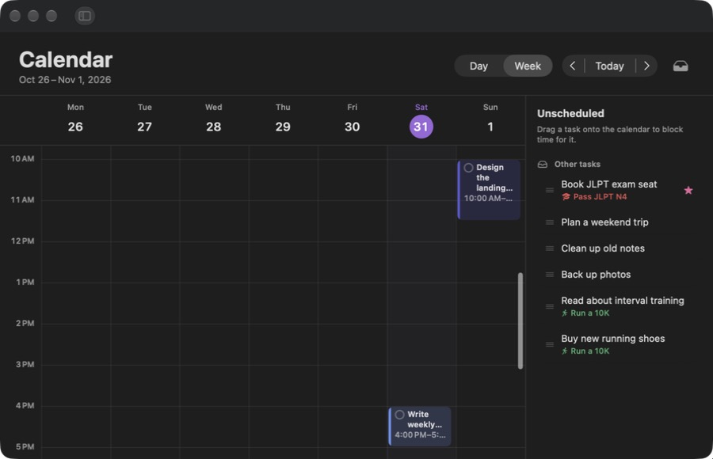
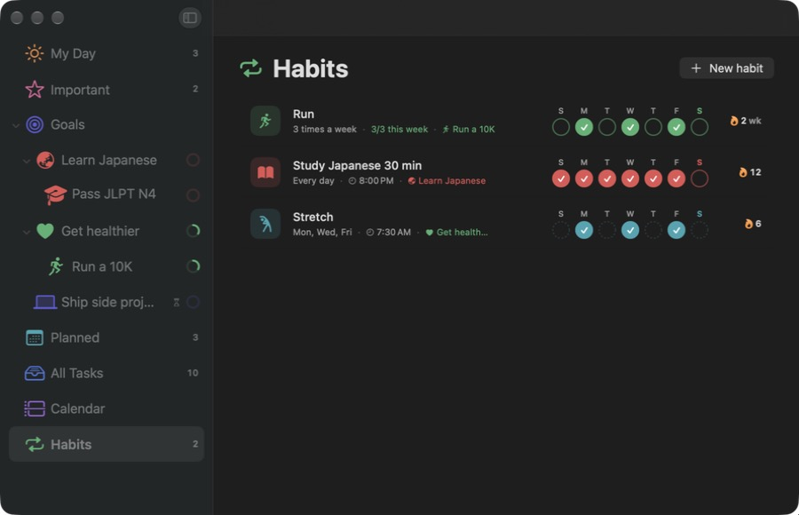
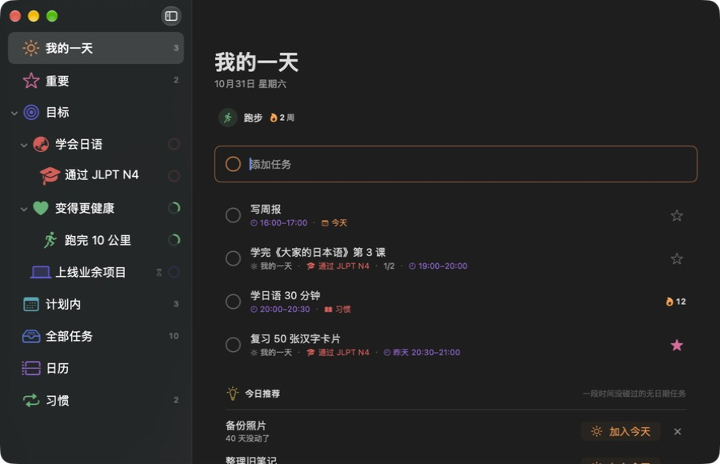

<h1 align="center">Horizon</h1>

<strong>A calm Mac planner for long-term goals, everyday tasks, and habits.</strong>

Break big goals into small steps, plan your day next to your Apple Calendar, and keep habits going.

  <a href="https://github.com/B0yangWong/Horizon-Releases/releases/download/v0.1.0/Horizon-0.1.0-macOS-universal.zip">Download for Mac</a> |
  <a href="#features">Features</a> |
  <a href="INSTALL.md">Installation</a> |
  <a href="PRIVACY.md">Privacy</a> |
  <a href="README.zh-CN.md">中文说明</a>

---

Set a long-term goal, add short-term goals underneath it if you like, and link tasks and habits to them. My Day brings today's tasks, your calendar events, and timed habits into one list. Undated tasks don't disappear: Horizon gently points out what has gone quiet. There is no app account, subscription, or cloud service to configure.

This repository hosts the downloadable app, documentation, and synthetic demo images. Application source code remains private. **Download the app ZIP in Releases; GitHub's automatically generated “Source code” archives contain this documentation, not the application.**

**0.1.0 preview · macOS 15 minimum build target · Universal (Apple silicon + Intel).** The Apple silicon build has been checked on the development Mac; Intel hardware, older macOS versions, and a separate clean-Mac first install have not been tested. The app is ad-hoc signed, without Developer ID signing or Apple notarization. macOS may block the first launch; read [Install and Open](INSTALL.md).

## Features

| Feature | What you can do |
| --- | --- |
| My Day | Pick what to focus on today. Tasks due today, tasks scheduled today, Apple Calendar events, and timed habits appear in one list in time order. The list starts fresh every day. |
| Goals | Create long-term goals and, optionally, short-term goals inside them. Deadlines are optional. Progress rolls up from tasks and short-term goals. |
| Goals overview | See every goal with its progress, add new ones, and find achieved or archived goals (archived goals can be restored). |
| Tasks | Add steps, notes, a due date (Today, Tomorrow, Next week, or pick a date on a calendar), a star for importance, and a link to any goal. |
| Habits | Repeat every day, on certain weekdays, or a number of times per week. Check in from a 7-day strip and watch the streak grow. Give a habit a set time if you like. |
| Calendar | Day and week views with your Apple Calendar events. Drag an unscheduled task onto the grid to block time for it, or double-click an empty slot to create one. |
| Two-way Apple Calendar sync | Scheduled tasks and timed habits are written to a calendar named “Horizon”. Moving, renaming, or deleting them in Apple Calendar updates Horizon. Completed tasks get a ✓ in their event title. Optional. |
| Don't let things slip | Undated tasks and goals with no activity for a while (14 days by default) get a quiet “gone quiet” hint. Each morning My Day suggests a few tasks that have sat untouched for at least 3 days. |
| Small details | Drawn-on checkmarks, a soft completion sound, confetti when you clear My Day or achieve a goal, drag to reorder, and Reduce Motion support. |
| English and Chinese | The interface follows your Mac's language: English or Simplified Chinese. |

## Preview

These are screenshots of the actual 0.1.0 build using in-memory, invented sample goals, tasks, and habits, with Apple Calendar turned off. They contain no personal data. Example content is not included in a fresh installation.

Goals overview, calendar, habits, and Chinese interface

## Install and Open

1. Download [Horizon-0.1.0-macOS-universal.zip](https://github.com/B0yangWong/Horizon-Releases/releases/download/v0.1.0/Horizon-0.1.0-macOS-universal.zip) from the [0.1.0 release](https://github.com/B0yangWong/Horizon-Releases/releases/tag/v0.1.0).
2. Unzip it and move `Horizon.app` into Applications. No Xcode or additional runtime is required.
3. Open the app. If macOS blocks an unverified developer, review the download and decide whether to trust it. Use only the manual exception described in [Apple's instructions](https://support.apple.com/en-us/102445). If the warning says the app will harm your computer or is damaged, stop and report it. Do not disable system security checks or run a quarantine-removal command.
4. Add a task to My Day or create your first goal. To see your calendar inside Horizon, choose **Connect** in My Day or the Calendar view and allow full calendar access. You can skip this.

`SHA256SUMS.txt` accompanies the release for checking download integrity. It does not verify publisher identity or imply Apple approval. See [Installation and Compatibility](INSTALL.md) for details.

## Everyday Controls

| Action | Shortcut |
| --- | --- |
| Jump to “Add a task” in the current list | `Command + N` |
| New goal | `Command + Shift + N` |
| My Day, Important, Goals, Planned, All Tasks, Calendar, Habits | `Command + 1` … `Command + 7` |
| Complete the selected task | `Command + D` |
| Add / remove the selected task from My Day | `Command + T` |
| Mark the selected task as important | `Command + I` |
| Delete the selected task | `Command + Delete` |
| Close the task panel | `Escape` |
| Settings | `Command + Comma` |

Click a task to open its panel; on narrow windows the panel floats over the list. Right-click tasks, goals, and habits for more actions. Double-click a habit to edit it.

## Your Data Stays on Your Mac

Goals, tasks, and habits are stored locally inside the app's sandbox container, `~/Library/Containers/app.horizon.mac/`. Nothing is uploaded to this repository by the app. There is no account, advertising, analytics upload, cloud sync service, or automatic update check.

Apple Calendar access is optional. When you allow it, Horizon reads events from the calendars you choose to show and writes your scheduled tasks and timed habits to a “Horizon” calendar. If that calendar lives in an iCloud or other online account, Apple or that provider syncs it like any other calendar. See [Privacy](PRIVACY.md).

Updates are manual: quit the app, then replace it. Your data stays in its container. Horizon 0.1.0 has no export or backup feature of its own; Time Machine and other Mac backups cover the container.

## Current Limits and Feedback

Horizon is a preview for local Mac use. It does not include an iPhone app, iCloud sync between Macs, notifications or reminder alerts, Apple Reminders integration, import/export, or collaboration. “Times per week” habits have no fixed days and are not written to Apple Calendar. Because the app is ad-hoc signed, macOS may ask for calendar access again after you install an update. See [Validation](VALIDATION.md) for what has and has not been checked.

For [bug reports and feature requests](https://github.com/B0yangWong/Horizon-Releases/issues/new/choose), include your app version, macOS version, and steps using invented content. Issues are public: do not attach real task lists, calendar details, or screenshots showing personal information. Read [Security](SECURITY.md) before reporting a vulnerability.

The app is free to download and run on your own Mac. This repository does not grant an open-source license to the application or icon. See [Usage](USAGE.md) and [Changelog](CHANGELOG.md).
