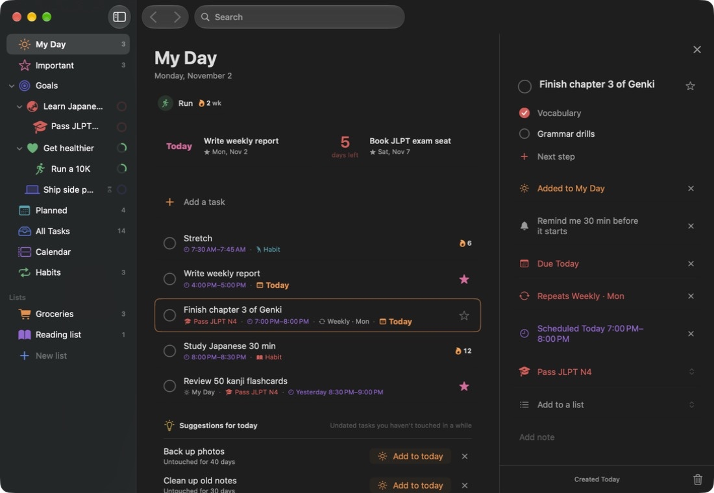
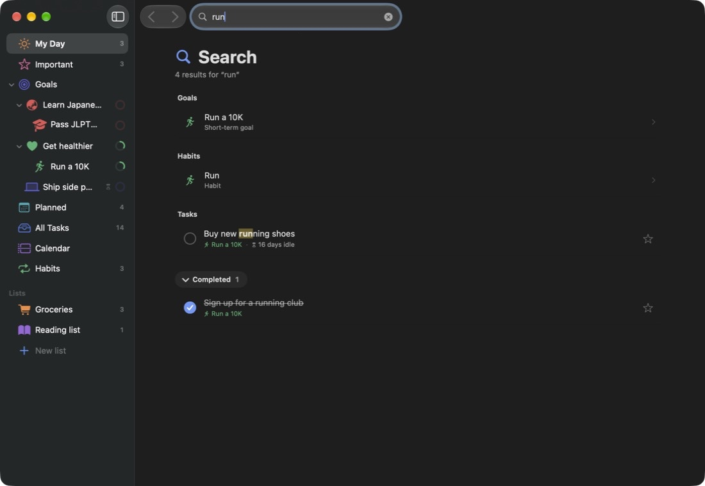

<h1 align="center">Horizon</h1>

<strong>A calm Mac planner for long-term goals, everyday tasks, and habits.</strong>

Break big goals into small steps, plan your day next to your Apple Calendar, and keep habits going.

  <a href="https://github.com/B0yangWong/Horizon-Releases/releases/download/v0.3.0/Horizon-0.3.0-macOS-universal.zip">Download for Mac</a> |
  <a href="#features">Features</a> |
  <a href="INSTALL.md">Installation</a> |
  <a href="PRIVACY.md">Privacy</a> |
  <a href="README.zh-CN.md">中文说明</a>

---

Set a long-term goal, add short-term goals underneath it if you like, and link tasks and habits to them. Keep everyday lists such as groceries or homework next to them. My Day brings today's tasks, your calendar events, timed habits, and a countdown to what's coming up into one place. Tasks can repeat, remind you, and be jotted down from any app with a keyboard shortcut; search finds anything, and Undo takes back a slip. Undated tasks don't disappear: Horizon gently points out what has gone quiet. There is no app account, subscription, or cloud service to configure.

This repository hosts the downloadable app, documentation, and synthetic demo images. Application source code remains private. **Download the app ZIP in Releases; GitHub's automatically generated “Source code” archives contain this documentation, not the application.**

**0.3.0 preview · macOS 15 minimum build target · Universal (Apple silicon + Intel).** The Apple silicon build has been checked on the development Mac; Intel hardware, older macOS versions, and a separate clean-Mac first install have not been tested. The app is ad-hoc signed, without Developer ID signing or Apple notarization. macOS may block the first launch; read [Install and Open](INSTALL.md).

## Features

| Feature | What you can do |
| --- | --- |
| My Day | Pick what to focus on today. Tasks due or scheduled today, Apple Calendar events, and timed habits appear in one list in time order; holidays and other all-day events sit on top. Right-click an event to remove it from today. |
| Countdown | At the top of My Day: the next few important tasks with a due date, goal deadlines, and calendar events that look like exams or deadlines, within 30 days, with the days left. Click one to open it; right-click to hide it. |
| Goals | Long-term goals with optional short-term goals inside them and optional deadlines. Progress rolls up from tasks and short-term goals; a goals overview shows everything, including achieved and archived goals. |
| Tasks | Steps, notes, a due date (including “This weekend”), importance, a goal, a list, a time block on the calendar, and a reminder. Drag a task onto My Day, Important, Planned, a list, or a goal in the sidebar to put it there. |
| Lists | Your own lists, such as “Groceries” or “Homework”, under the smart lists, each with a name, color, and icon. Drag to reorder. A task can be in a list and linked to a goal at the same time. |
| Repeating tasks | Daily, weekdays, weekly, monthly, yearly, or a custom rule such as every 2 weeks on Monday and Thursday. Completing one creates the next with its time and reminder; unchecking it takes that back. |
| Reminders | “Remind me” 10 or 30 minutes before a task starts, or at a time you pick. Optional automatic reminders before scheduled tasks, on the morning a task is due, and at habit times. Complete or snooze right from the notification. |
| Quick capture | A global shortcut (⌃⌥N by default, changeable in Settings) opens a slim “Add a task” bar over any app. Type “Tomorrow 3pm call Alex !”, “every mon and thu gym”, or “每周一三五晚上8点 跑步 @运动” and Horizon fills in the date, time, repeat, importance, “#goal”, and “@list”. A menu bar window shows today's tasks and habits. |
| Search | ⌘F searches task titles, notes, and steps (completed tasks too), goal, habit, and list names, and Apple Calendar events. Results are grouped, with the matching words marked; an event opens in the month calendar, pointed out for a moment. |
| Undo | ⌘Z takes back deleting, completing, My Day, importance, date, time, repeat, reminder, goal and list changes, calendar moves, and habit check-ins. After a delete, an “Undo” bar appears for a few seconds. |
| Habits | Every day, on certain weekdays, or a number of times per week, with a 7-day check-in strip, streaks, and an optional set time. |
| Calendar | Day, week, and month views. Drag tasks onto the grid to schedule them, or onto a day to make them due. Scroll over the month to turn to the next or previous one. Show or hide each calendar, grouped by account. |
| Apple Calendar sync | Scheduled tasks, tasks with a due date (as all-day events), and timed habits are written to a “Horizon” calendar; moving, renaming, or deleting them in Apple Calendar updates Horizon. “Import from Calendar” in Planned adds upcoming events as tasks that keep following their event. Optional. |
| Don't let things slip | Undated tasks and goals with no activity for a while get a quiet “gone quiet” hint, and My Day suggests a few tasks untouched for at least 3 days. Completed tasks stay in All Tasks. |
| Backup and export | One automatic backup file, replaced as you work, in a folder you can choose. Export everything as a JSON file, or import and restore one; the current data is saved first. |
| Comfort | Text size from 85% to 150% (⌘+ / ⌘−), Back and Forward between lists, drag the sidebar into your own order, a sidebar that slides over narrow windows, click empty space to close the task panel, English and Simplified Chinese. |

## Preview

These are screenshots of the actual 0.3.0 build using in-memory, invented sample goals, tasks, and habits, with Apple Calendar turned off. They contain no personal data. Example content is not included in a fresh installation.

Search, goals, month calendar, habits, and Chinese interface

## Install and Open

1. Download [Horizon-0.3.0-macOS-universal.zip](https://github.com/B0yangWong/Horizon-Releases/releases/download/v0.3.0/Horizon-0.3.0-macOS-universal.zip) from the [0.3.0 release](https://github.com/B0yangWong/Horizon-Releases/releases/tag/v0.3.0).
2. Unzip it and move `Horizon.app` into Applications. No Xcode or additional runtime is required.
3. Open the app. If macOS blocks an unverified developer, review the download and decide whether to trust it. Use only the manual exception described in [Apple's instructions](https://support.apple.com/en-us/102445). If the warning says the app will harm your computer or is damaged, stop and report it. Do not disable system security checks or run a quarantine-removal command.
4. Horizon asks once whether it may send notifications (for reminders). To see your calendar inside Horizon, choose **Connect** in My Day or the Calendar view and allow full calendar access. Both are optional.

`SHA256SUMS.txt` accompanies the release for checking download integrity. It does not verify publisher identity or imply Apple approval. See [Installation and Compatibility](INSTALL.md) for details.

## Everyday Controls

| Action | Shortcut |
| --- | --- |
| Quick capture from any app | `Control + Option + N` (changeable) |
| Jump to “Add a task” in the current list | `Command + N` |
| New goal | `Command + Shift + N` |
| New list | `Command + Shift + L` |
| Search | `Command + F` |
| Undo / Redo | `Command + Z` / `Command + Shift + Z` |
| Back / Forward between lists | `Command + [` / `Command + ]` |
| Sidebar lists, in their current order | `Command + 1` … `Command + 7` |
| Complete the selected task | `Command + D` |
| Add / remove the selected task from My Day | `Command + T` |
| Mark the selected task as important | `Command + I` |
| Delete the selected task | `Command + Delete` |
| Bigger / smaller / default text | `Command + +` / `Command + −` / `Command + 0` |
| Close the task panel | `Escape`, or click empty space |
| Settings | `Command + Comma` |

When adding a task, a date (“tomorrow”, “周五”, “this weekend”, “11/20”), a time (“3pm”, “下午3点”), a length (“1h”, “半小时”), a repeat (“every mon and wed”, “every other week”, “每天”, “每周一三五”, “隔周”, “工作日”), `!` for important, `#` plus part of a goal's name, and `@` plus part of a list's name are recognized and shown as chips before you press Return. This can be turned off in Settings → Quick Capture. Right-click tasks, goals, habits, sidebar lists, and My Day events for more actions.

## Your Data Stays on Your Mac

Goals, tasks, lists, habits, and the backup file are stored locally inside the app's sandbox container, `~/Library/Containers/app.horizon.mac/`. Nothing is uploaded to this repository by the app. There is no account, advertising, analytics upload, cloud sync service, or automatic update check. Reminders are local notifications.

Apple Calendar access is optional. When you allow it, Horizon reads events from the calendars you choose to show and writes your scheduled tasks, due dates, and timed habits to a “Horizon” calendar. If that calendar lives in an iCloud or other online account, Apple or that provider syncs it like any other calendar. See [Privacy](PRIVACY.md).

Updates are manual: quit the app, then replace it. Your data stays in its container. From 0.2.0 on, macOS keeps Horizon's calendar permission across updates.

## Current Limits and Feedback

Horizon is a preview for local Mac use. It does not include an iPhone app, iCloud sync between Macs, Apple Reminders integration, collaboration, or automatic updates. The automatic backup keeps one file, replaced each time; export a copy if you want to keep a particular point in time. “Times per week” habits have no fixed days and are not written to Apple Calendar. Date recognition in quick capture follows simple rules and can misread unusual phrasing, which is why it is shown before adding. See [Validation](VALIDATION.md) for what has and has not been checked.

For [bug reports and feature requests](https://github.com/B0yangWong/Horizon-Releases/issues/new/choose), include your app version, macOS version, and steps using invented content. Issues are public: do not attach real task lists, calendar details, backup files, or screenshots showing personal information. Read [Security](SECURITY.md) before reporting a vulnerability.

The app is free to download and run on your own Mac. This repository does not grant an open-source license to the application or icon. See [Usage](USAGE.md) and [Changelog](CHANGELOG.md).
