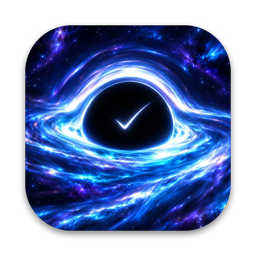
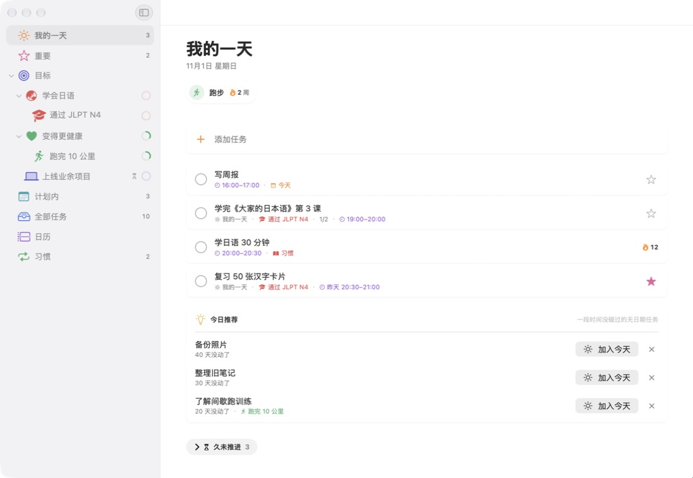
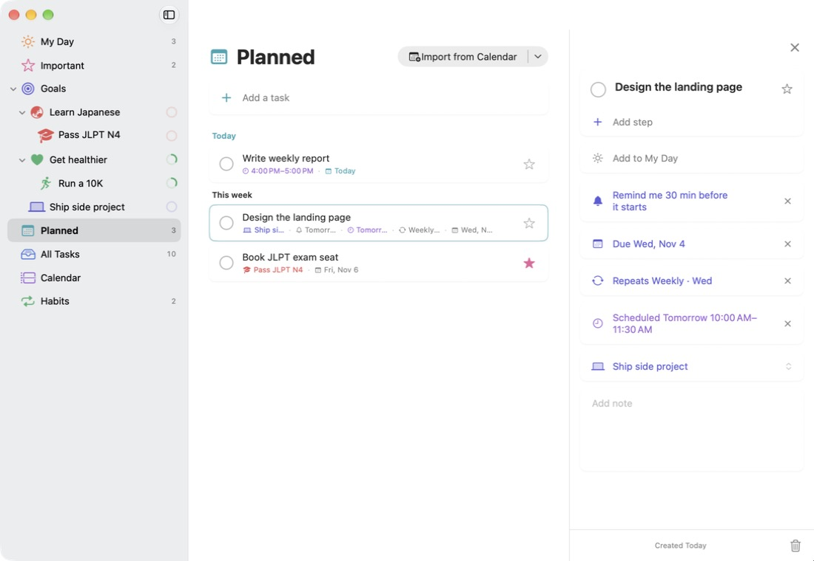
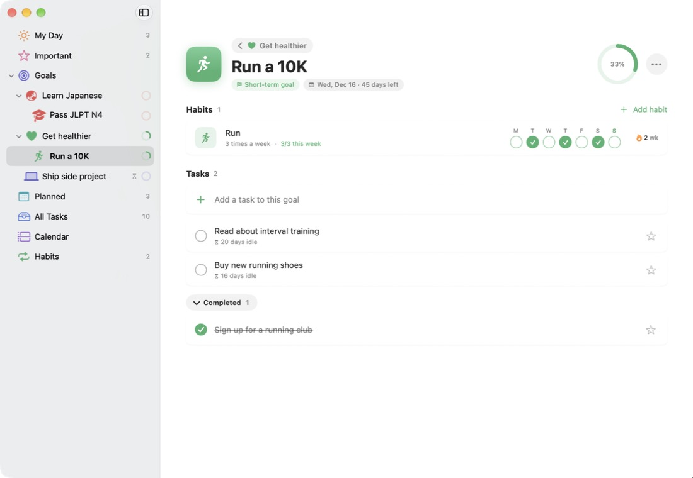
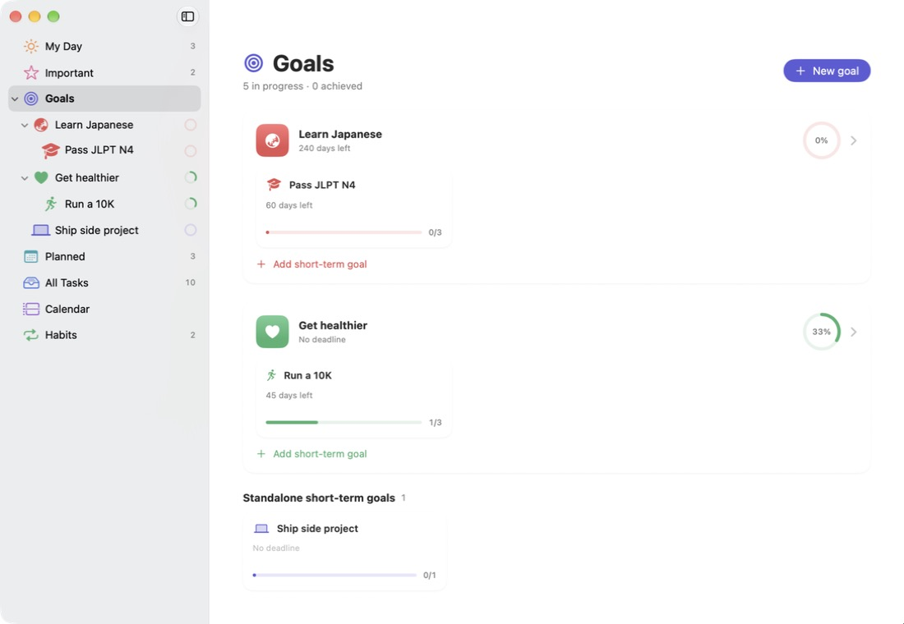
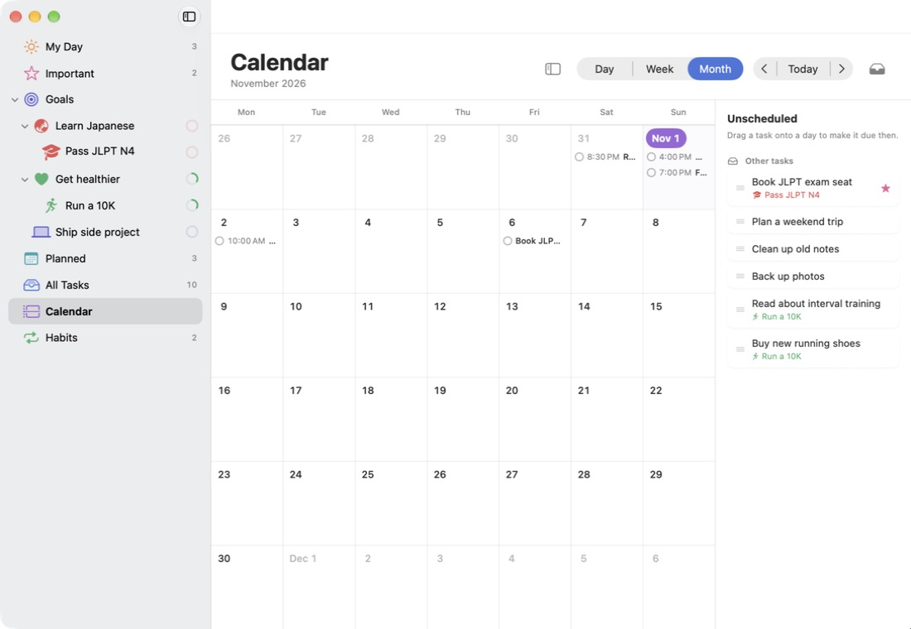
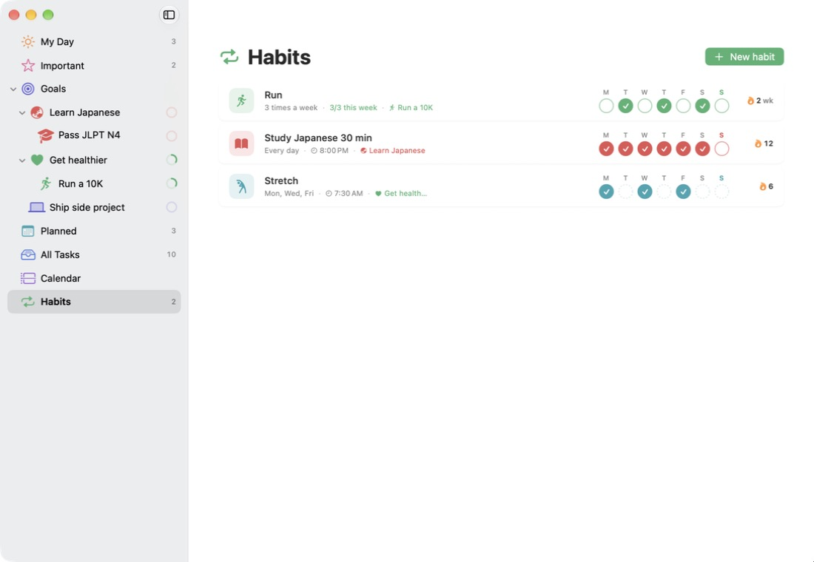

<h1 align="center">Horizon</h1>

<strong>把长期目标、每日任务和习惯放进一个安静的 Mac 计划工具。</strong>

把大目标拆成小步骤，对照苹果日历安排今天，让习惯坚持下去。

  <a href="https://github.com/B0yangWong/Horizon-Releases/releases/download/v0.2.0/Horizon-0.2.0-macOS-universal.zip">下载 Mac 版</a> |
  <a href="INSTALL.md">安装说明</a> |
  <a href="PRIVACY.md">隐私说明</a> |
  <a href="README.md">English</a>

---

Horizon 是一款原生 macOS 计划应用。设定长期目标，可以在下面再放短期目标，也可以不放；任务和习惯都能关联到目标。“我的一天”把今天的任务、日历日程和有固定时间的习惯合成一个列表。任务可以重复、可以提醒，也能在任何 app 里用快捷键随手记下。没有截止日期的任务也不会被遗忘：一段时间没动的事项会被温和地标出来。无需注册账户或配置云端服务。

本仓库只提供应用下载、使用文档和虚构示例截图，**不公开应用源码**。请下载 Releases 中的应用 ZIP；GitHub 自动生成的“Source code”压缩包只是本仓库的文档，不是安装包。

**0.2.0 预览版：最低构建目标为 macOS 15，通用安装包包含 Apple 芯片与 Intel 架构。** 已在开发用 Apple 芯片 Mac 上检查；Intel 真机、较旧的 macOS 和另一台全新 Mac 的首次安装尚未实测。应用采用临时本地签名，没有 Apple 开发者身份签名或公证，首次打开可能被系统拦截，详见[安装说明](INSTALL.md)。

## 主要功能

| 功能 | 使用方式 |
| --- | --- |
| 我的一天 | 选出今天要做的事。今天到期、今天排了时间的任务、苹果日历日程和有固定时间的习惯按时间排在一个列表里；节假日等全天日程显示在最上方，右键可以从今天移除。 |
| 目标 | 长期目标下可以放短期目标，截止日期可有可无。进度根据任务和短期目标自动汇总；目标总览里能看到全部目标，包括已达成和已归档的。 |
| 任务 | 步骤、备注、截止日期、重要标记、关联目标、在日历上排时间，以及提醒。 |
| 重复任务 | 每天、工作日、每周、每月、每年，或自定义，例如每 2 周的周一和周四。完成后自动生成下一次，时间和提醒一起带过去；取消勾选会撤回刚生成的那一次。 |
| 提醒 | “提醒我”可以选开始前 10 分钟、30 分钟或自定时间。还可以开启自动提醒：排了时间的任务开始前、到期当天早上、习惯到点。通知上可以直接完成或稍后提醒。 |
| 快速记录 | 全局快捷键（默认 ⌃⌥N，可在设置里改）在任何 app 上方弹出一根“添加任务”细长条。输入“明天下午3点 交报告 !”或“Tomorrow 3pm call Alex”，会自动识别日期、时间、重要标记和“#目标”。菜单栏里还能查看并勾选今天的任务和习惯。 |
| 习惯 | 每天、每周固定几天或每周几次。在最近 7 天的打卡格里打卡，查看连续天数，也可以设定固定时间。 |
| 日历 | 日、周、月视图。把任务拖到时间格上排时间，拖到某一天设为当天到期。日历按账户分组列出，可以逐个显示或隐藏。 |
| 苹果日历同步 | 排了时间的任务、有截止日期的任务（全天日程）和有固定时间的习惯会写入“Horizon”日历；在苹果日历里移动、改名或删除，Horizon 会同步更新。“计划内”的“从日历导入”可以把即将到来的日程加成任务，之后继续跟随日程变化。可选功能。 |
| 不让事情溜走 | 没有截止日期的任务和一段时间没有进展的目标会得到“久未推进”提示；“我的一天”每天推荐几个至少 3 天没动过的任务。完成的任务都留在“全部任务”里。 |
| 备份与导出 | 自动备份只保留一个文件、随时覆盖，位置可以自选。也可以把全部内容导出为 JSON 文件，或导入恢复；恢复前会先保存当前数据。 |
| 使用细节 | 文字大小可在 85% 到 150% 之间调整（⌘+ / ⌘−），左侧栏目可以拖动排序，点空白处关闭任务面板，支持英文和简体中文界面。 |

## 界面预览

以下是 0.2.0 实际构建版本的截图，使用内存中的虚构目标、任务和习惯，并关闭了苹果日历，不含任何个人资料。全新安装不包含这些示例内容。

目标、月视图日历和习惯

## 安装与打开

1. 从 [0.2.0 版本](https://github.com/B0yangWong/Horizon-Releases/releases/tag/v0.2.0)下载 [Horizon-0.2.0-macOS-universal.zip](https://github.com/B0yangWong/Horizon-Releases/releases/download/v0.2.0/Horizon-0.2.0-macOS-universal.zip)。
2. 解压后把 `Horizon.app` 拖入“应用程序”。不需要 Xcode 或其他运行环境。
3. 打开应用。如果系统提示无法验证开发者，请确认你信任这个下载，然后仅按 [Apple 官方说明](https://support.apple.com/zh-cn/102445)手动允许。如果提示“将损害电脑”或“已损坏”，请停止并反馈。不要关闭系统安全检查，也不要运行移除隔离标记的命令。
4. Horizon 会询问一次能否发送通知（用于提醒）。想在 Horizon 里看到日历，点“我的一天”或日历页里的“连接”，并允许完整的日历访问权限。两项都可以跳过。

发布页附带 `SHA256SUMS.txt`，用于核对下载文件是否完整；它不能证明发布者身份，也不代表 Apple 认可。详见[安装说明](INSTALL.md)。

## 常用快捷键

| 操作 | 快捷键 |
| --- | --- |
| 在任何 app 中快速记录 | `Control + Option + N`（可修改） |
| 跳到当前列表的“添加任务” | `Command + N` |
| 新建目标 | `Command + Shift + N` |
| 按当前顺序切换左侧栏目 | `Command + 1` … `Command + 7` |
| 完成选中的任务 | `Command + D` |
| 把选中的任务加入或移出“我的一天” | `Command + T` |
| 标记选中的任务为重要 | `Command + I` |
| 删除选中的任务 | `Command + Delete` |
| 放大 / 缩小 / 默认文字大小 | `Command + 加号` / `Command + 减号` / `Command + 0` |
| 关闭任务面板 | `Escape`，或点空白处 |
| 设置 | `Command + 逗号` |

添加任务时，日期（“明天”“周五”“11月20日”“tomorrow”）、时间（“下午3点”“3pm”）、时长（“1小时”“半小时”）、`!`（重要）和 `#` 加目标名的一部分都会被识别，并在按回车前以小标签显示；可在“设置 → 快速记录”中关闭。右键任务、目标、习惯、左侧栏目和“我的一天”里的日程有更多操作。

## 资料保存在你的 Mac 上

目标、任务、习惯和备份文件保存在应用的沙盒目录 `~/Library/Containers/app.horizon.mac/` 中，应用不会上传到本仓库。没有账户、广告、统计上传、云同步服务或自动更新检查。提醒是本机通知。

苹果日历访问是可选的。允许后，Horizon 会读取你选择显示的日历中的日程，并把排了时间的任务、截止日期和有固定时间的习惯写入“Horizon”日历。如果这个日历位于 iCloud 或其他在线账户，会由 Apple 或该服务商像其他日历一样同步。详见[隐私说明](PRIVACY.md)。

更新需要手动进行：退出应用后替换即可，资料保留在原目录。从 0.2.0 起，更新后系统会保留 Horizon 的日历权限。

## 当前限制与反馈

Horizon 是本机使用的预览版，不包含 iPhone 应用、多台 Mac 之间的 iCloud 同步、苹果“提醒事项”集成、协作或自动更新。自动备份只保留一个文件并每次覆盖；想保留某个时间点，请另外导出一份。“每周几次”的习惯没有固定日子，不会写入苹果日历。快速记录的日期识别按简单规则进行，少见的说法可能识别错，所以会在添加前显示出来。已检查与未检查的范围见[验证范围](VALIDATION.md)。

[问题反馈和功能建议](https://github.com/B0yangWong/Horizon-Releases/issues/new/choose)请写明应用版本、macOS 版本，并用虚构内容描述复现步骤。Issue 是公开的，请不要附上真实的任务清单、日历内容、备份文件或含有个人信息的截图。报告安全问题前请先阅读[安全说明](SECURITY.md)。

应用可免费下载并在自己的 Mac 上运行。本仓库不授予应用或图标的开源许可，详见[使用范围](USAGE.md)和[更新记录](CHANGELOG.md)。
