<h1 align="center">Horizon</h1>

<strong>一个配了 AI 秘书的待办 app，秘书懂你的一天。</strong>

任务、目标、习惯和苹果日历放在一个安静的 Mac 应用里，再配一位秘书：它读懂这些内容，告诉你先做什么，帮你归档随手记下的事，在事情被拖掉之前提醒你。它用的是<strong>你自己的</strong> Claude Code 或 Codex 和你自己的订阅。

  <a href="https://github.com/B0yangWong/Horizon-Releases/releases/download/v0.4.1/Horizon-0.4.1-macOS-universal.zip"><strong>下载 Mac 版</strong></a> |
  <a href="#认识你的秘书">认识秘书</a> |
  <a href="#两分钟接上-ai">接上 AI</a> |
  <a href="#底下是一个完整的待办应用">待办功能</a> |
  <a href="PRIVACY.md">隐私说明</a> |
  <a href="README.md">English</a>

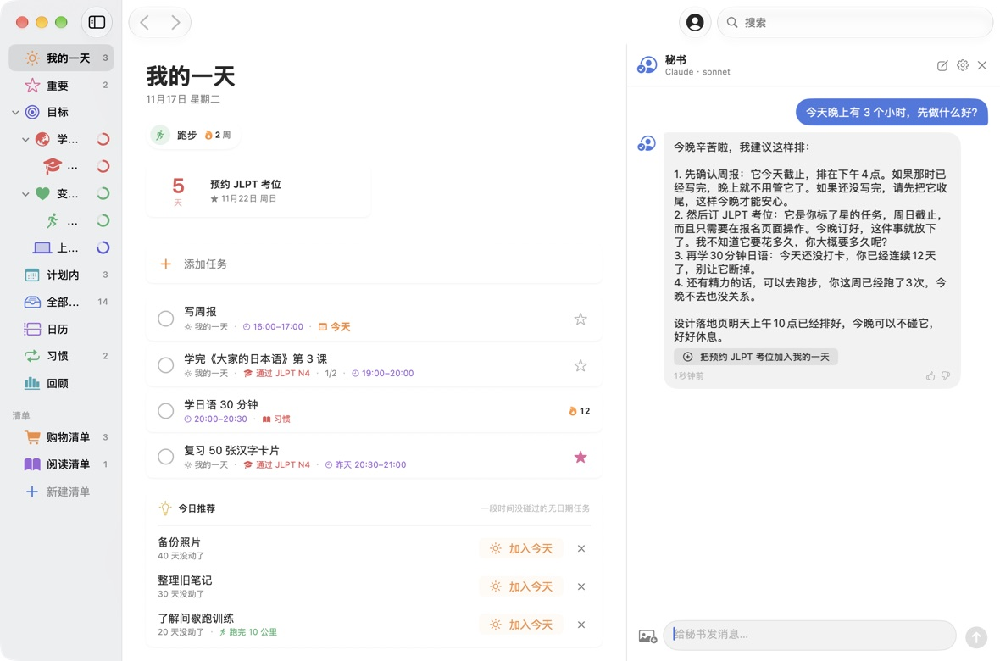

秘书（Claude Code，Sonnet）针对虚构示例任务给出的真实回答。

---

## 认识你的秘书

大多数待办 app 只是帮你存清单。Horizon 的秘书会**把清单和你的日历、习惯、目标放在一起读懂，再帮你行动起来**。

| | 它能帮你做什么 |
| --- | --- |
| **“先做什么好？”** | 用大白话问它。它根据你真实的任务、截止日期、时间安排、连续打卡和日历来回答，给出一个清楚的顺序。回答以卡片呈现，附带按钮（加入我的一天、设提醒、移到某个清单、标记完成），你不点就什么都不改。也可以发截图给它。 |
| **读懂每个任务** | 在任务里点**让秘书看看**，它会读备注、步骤和附件（PDF、图片、链接），告诉你这件事有多重要、为什么，真正的截止时间和要求（并标明出处），下一步做什么，需要计划的任务再列出步骤。 |
| **在事情被拖掉前开口** | 早间简报、重要的事快到时的提醒、任务卡住时问一句、连续打卡很久时鼓励一下。频率（从不到每天最多 6 条）、免打扰时段和语气由你设定，说什么由它判断。它答应过帮你盯着的事，到时一定会提醒。 |
| **归档随手记** | 在任何地方按 ⌃⌥N 打字，或按住 ⌃⌥V 说话。内容会先立刻存为任务，再由秘书归档：设好日期和类别的任务、某个清单里的一项、一个新目标，或者一条关于你的记忆。还可以把当前 app 里选中的文字、邮件或网页一起带进来。 |
| **会记忆，会学习** | 它会记住关于你的简短信息（你的学期、作息、习惯偏好），并参考你写的“关于我”。每条消息都可以点赞或点踩；每三天它会根据你的反馈重写一份简短的工作守则，你可以查看和修改。 |
| **整理一大堆任务** | 在“全部任务”按类别分组时，点**让秘书分类**，它会把任务分进作业、考试、会议、申请等类别。 |

**它提建议，你做决定。**除了归档随手记（可以关闭），你的清单不经你点击不会有任何改动。

## 两分钟接上 AI

Horizon **没有自己的 AI 服务，不用 API 密钥，也不卖 AI 订阅。**秘书使用下面任意一个工具，由**你自己**在 Mac 上安装并登录：

| 工具 | 使用的账户 | 安装（在“终端”里） | 登录 |
| --- | --- | --- | --- |
| [Claude Code](https://github.com/anthropics/claude-code) | 包含 Claude Code 的 Claude 订阅 | `brew install --cask claude-code` | `claude auth login` |
| [Codex](https://github.com/openai/codex) | 包含 Codex 的 ChatGPT 订阅 | `brew install --cask codex` | `codex login` |

然后点 Horizon 右上角的人像图标（或打开**设置 → 秘书**），点**打开**，选择工具和模型，再点**测试**。Horizon 会显示每个工具是否已安装、是否已登录。用量计入你自己订阅的额度，Horizon 接触不到你的登录信息。建议打开**登录时打开 Horizon**，这样不用手动打开 app，秘书也能找到你。

秘书**默认关闭，需要你自己打开**；不打开秘书，Horizon 的其他功能照常使用。

**哪些内容会离开你的 Mac：**秘书打开期间，每次请求会通过你选的工具，把这项工作需要的内容发送给 Anthropic（Claude Code）或 OpenAI（Codex）：相关任务及其备注、步骤、附件文字或图片；你的清单、目标、类别和习惯；苹果日历日程（如果已连接，范围是过去一年到未来两年）；你写的“关于我”；秘书的记忆；以及最近的聊天记录。这些数据适用对方的条款和隐私政策。Horizon 调用工具时会关闭它自带的工具、插件（MCP 服务器）和会话保存。随时关闭秘书，就不会再发送任何内容。详见[隐私说明](PRIVACY.md)。

**平时就在用 Claude Code 或 Codex？**在“设置 → 秘书”里点**添加到 Claude Code / 添加到 Codex**，之后*你*在终端里使用它们时，它们就能查看你的 Horizon 任务，并按你的要求修改。

## 底下是一个完整的待办应用

秘书建立在一个完整、快速的原生待办应用之上；即使不用秘书，它本身也很好用。

| 功能 | 可以做什么 |
| --- | --- |
| 我的一天 | 今天的日程按时间排在最上面（可折叠）；下面是你挑的任务、今天到期或排了时间的任务，以及定时习惯。倒计时显示最近的重要截止日期，推荐会把一段时间没动的任务找回来。 |
| 目标 | 长期目标下可放短期目标，截止日期可选；进度由任务汇总。任务和习惯都能关联到目标。 |
| 任务 | 步骤、可贴截图和文件的备注、截止日期、重要标记、清单、类别、日历时间块、重复和提醒。 |
| 随手记 | 在任何 app 里按 ⌃⌥N。输入“明天下午3点 给小王打电话 !”“每周一三五晚上8点 跑步 @运动”或“every mon and thu gym”，日期、时间、重复、重要、`#目标` 和 `@清单` 边输边识别。 |
| 语音随手记 | ⌃⌥V。每个快捷键都可以设为短按或长按，所以同一组按键可以两用：短按打字，长按说话。 |
| 回顾 | 本周或本月完成了什么：按天、按类别、按目标，以及习惯打卡。 |
| 清单与类别 | 自建清单（购物、作业……）。“全部任务”可以按截止日期或类别分组，所有内容都能拖动排序。 |
| 习惯 | 每天、每周固定几天或每周 N 次，带连续天数和可选的固定时间。 |
| 日历 | 日、周、月视图，把任务拖到时间格上排程。可与苹果日历里的“Horizon”日历双向同步（可选）。 |
| 搜索与撤销 | ⌘F 搜索任务、目标、习惯、清单和日程；⌘Z 撤销删除、完成、移动和打卡。 |
| 备份与更新 | 一个自动备份，加上最近 7 天每天一份；可导出 JSON。经过签名校验的应用内更新。 |
| 使用细节 | 中文或英文界面，日期显示为“后天”或具体日期，文字大小 85%–150%，任务列表可完全用键盘操作。 |

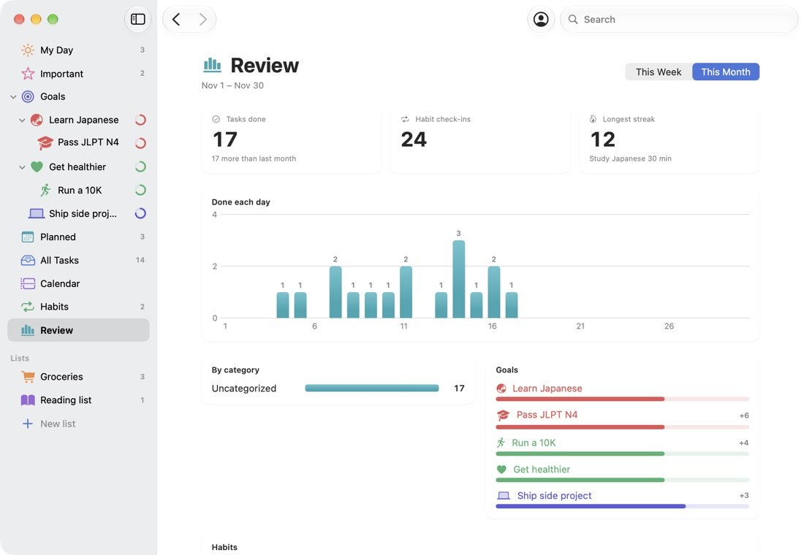

更多截图：英文界面、任务面板、搜索、目标、月历、习惯、打开前的秘书

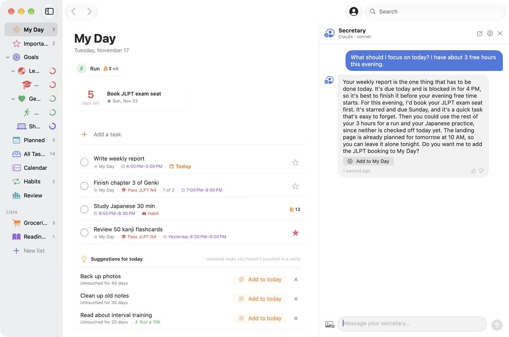

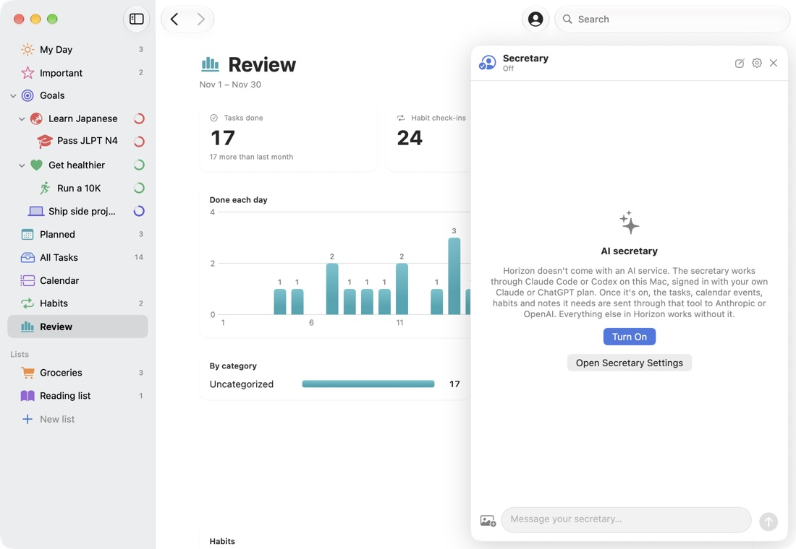

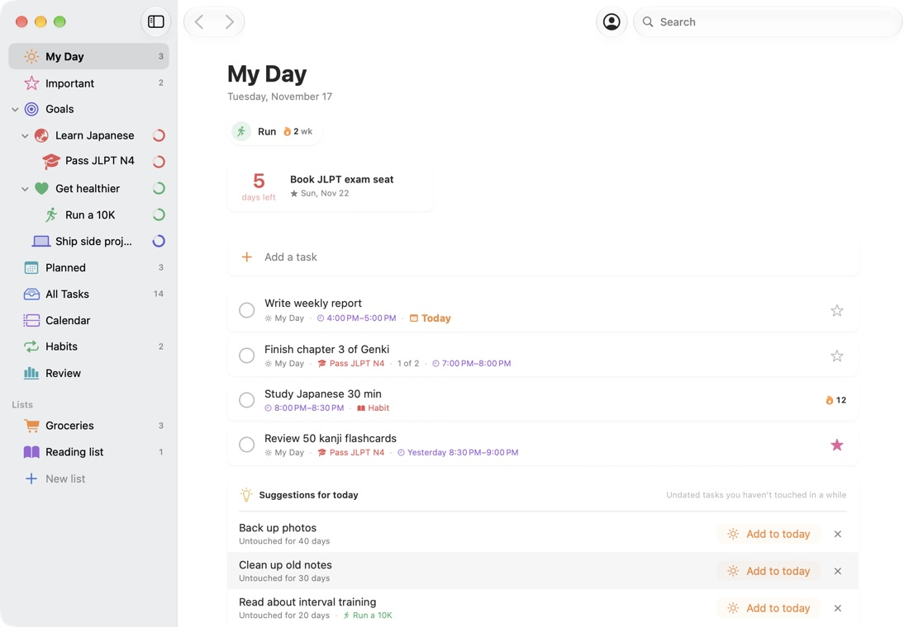

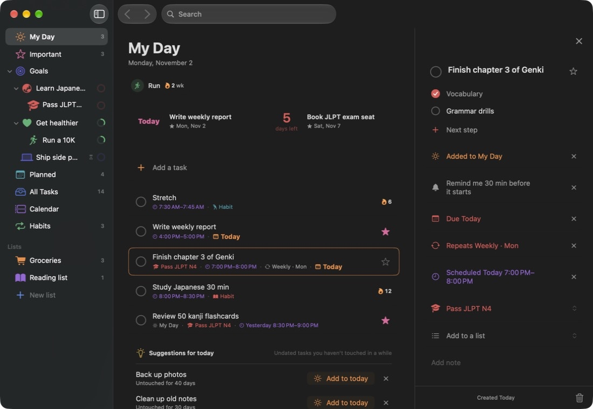

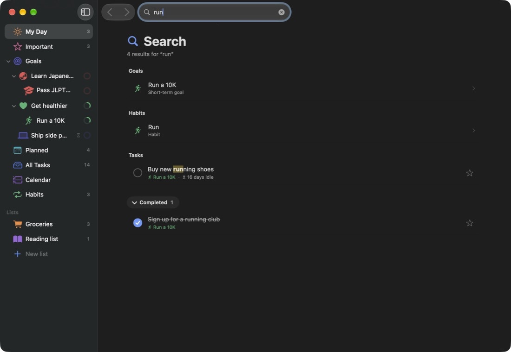

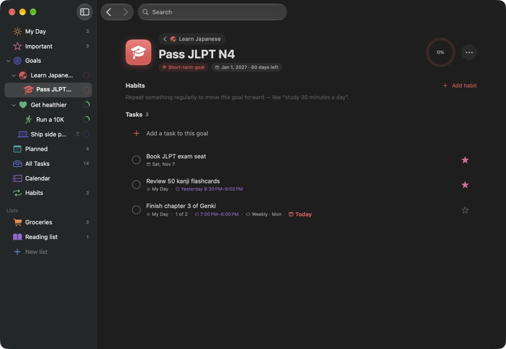

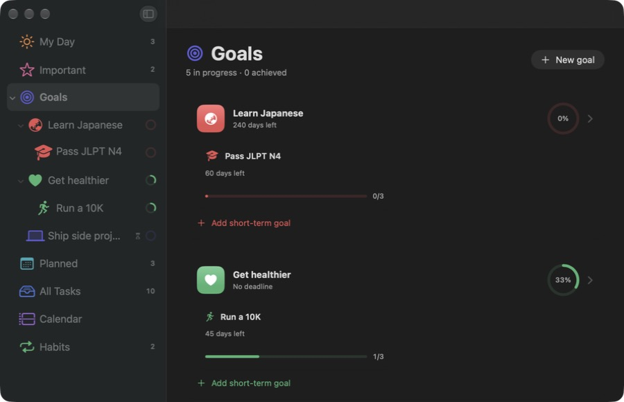

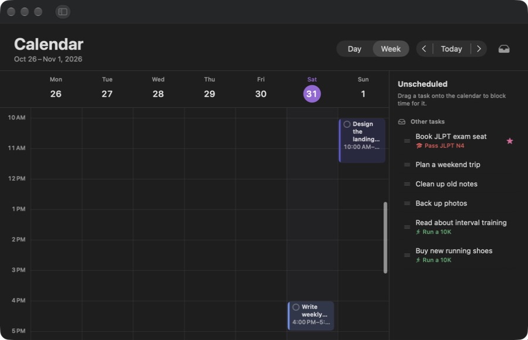

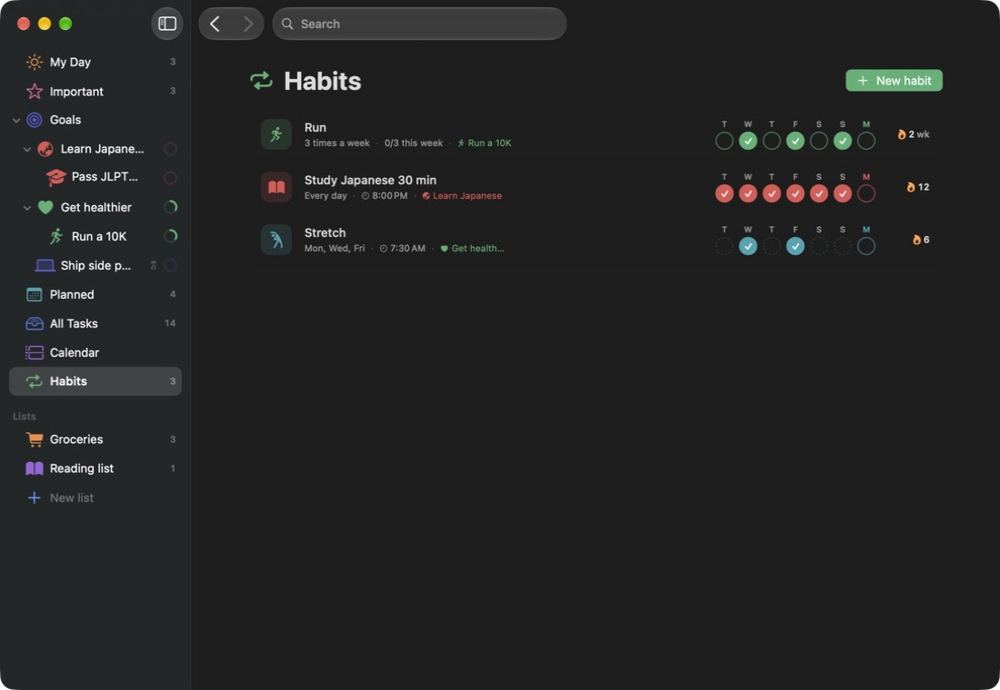

所有截图都使用内存中的虚构示例数据，并关闭了苹果日历，不含个人资料。秘书对话是它对这些示例数据的真实回答。任务面板、搜索、目标、月历和习惯的截图来自 0.3.0，现在的外观相同。

## 安装

**0.4.1 预览版 · macOS 15 或更高 · 通用版（Apple 芯片 + Intel）· 个人使用免费。**

1. 从[最新版本页](https://github.com/B0yangWong/Horizon-Releases/releases/latest)下载 [Horizon-0.4.1-macOS-universal.zip](https://github.com/B0yangWong/Horizon-Releases/releases/download/v0.4.1/Horizon-0.4.1-macOS-universal.zip)。GitHub 自动生成的“Source code”压缩包只是文档，不是应用。
2. 解压后把 `Horizon.app` 拖进“应用程序”（应用内更新需要它放在那里）。
3. 打开应用。Horizon 为临时本地签名，没有 Apple 开发者身份签名或公证，首次打开可能被系统拦截。确认信任这个下载后，只按 [Apple 官方说明](https://support.apple.com/zh-cn/102445)手动允许。如果系统提示“已损坏”或“将损害你的电脑”，请停止并反馈。不要关闭系统安全检查。
4. Horizon 会询问一次通知权限（用于提醒）。日历、麦克风、读取其他 app 的选中内容都只在第一次用到时询问，全部可选。

**更新：**从 0.4.0 起，点左侧栏底部的“更新到 …”即可。从 0.3.0 或更早版本升级：退出后替换应用再打开，首次启动会把资料从旧沙盒目录复制出来。可以用 `SHA256SUMS.txt` 核对下载文件（它只核对文件，不能证明发布者）。Apple 芯片版本已在开发用 Mac 上检查；Intel 真机、旧版 macOS 和全新 Mac 首次安装尚未实测。详见[安装说明](INSTALL.md)和[验证说明](VALIDATION.md)。

## 快捷键

| 操作 | 快捷键 |
| --- | --- |
| 在任何 app 里随手记 / 语音随手记 | `⌃⌥N` / `⌃⌥V`（可改，可设短按或长按） |
| 在当前列表添加任务 | `⌘N` |
| 新建目标 / 新建清单 | `⇧⌘N` / `⇧⌘L` |
| 搜索、撤销、重做 | `⌘F`、`⌘Z`、`⇧⌘Z` |
| 栏目间返回 / 前进 | `⌘[` / `⌘]` |
| 按顺序切换左侧栏目 | `⌘1` … `⌘8` |
| 选中任务：完成 / 我的一天 / 重要 / 删除 | `⌘D` / `⌘T` / `⌘I` / `⌘⌫` |
| 任务列表里 | `↑` `↓` 移动，`⇧↑` `⇧↓` 多选，`空格` 完成，`回车` 打开 |
| 文字大小 | `⌘+` / `⌘−` / `⌘0` |
| 关闭任务面板 / 秘书 | `Esc` 或点空白处 / 点空白处 |

## 资料留在你的 Mac 上

任务、目标、习惯、附件、秘书的聊天和记忆以及备份都保存在本机 `~/Library/Application Support/Horizon/`。没有 Horizon 账户、广告、统计上传或云同步。Horizon 自己只会联系 GitHub：每天检查一次更新（可关闭），以及下载你选择安装的更新。资料只会经由你打开的功能离开 Mac：AI 秘书（通过你自己的工具发给 Anthropic 或 OpenAI）、苹果日历（由你的日历服务商同步），以及语音随手记在你的语言无法本机识别时（使用 Apple 的语音服务）。详见[隐私说明](PRIVACY.md)和[安全说明](SECURITY.md)。

## 限制与反馈

Horizon 是供单台 Mac 使用的预览版：没有 iPhone 版、多台 Mac 同步、苹果“提醒事项”集成或协作功能。秘书只能在 Horizon 运行时主动发消息，水平取决于你选的模型，也可能出错。日期识别基于简单规则，会在添加前先显示识别结果。

[报告问题或提建议](https://github.com/B0yangWong/Horizon-Releases/issues/new/choose)时，请写明应用版本、macOS 版本和用虚构内容复现的步骤。Issue 是公开的：不要附上真实任务、日历详情、聊天记录、备份文件或含个人信息的截图。安全漏洞请看[安全说明](SECURITY.md)，更新内容见[更新记录](CHANGELOG.md)。

## 使用条款

**仅限个人、非商业使用，免费。**未经书面许可，不得出售 Horizon、对其收费、再分发（包括修改或改名后的版本），或把它用于任何付费产品或服务。源码不公开，不授予任何开源许可。完整条款见[使用条款](USAGE.md)。
