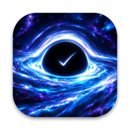
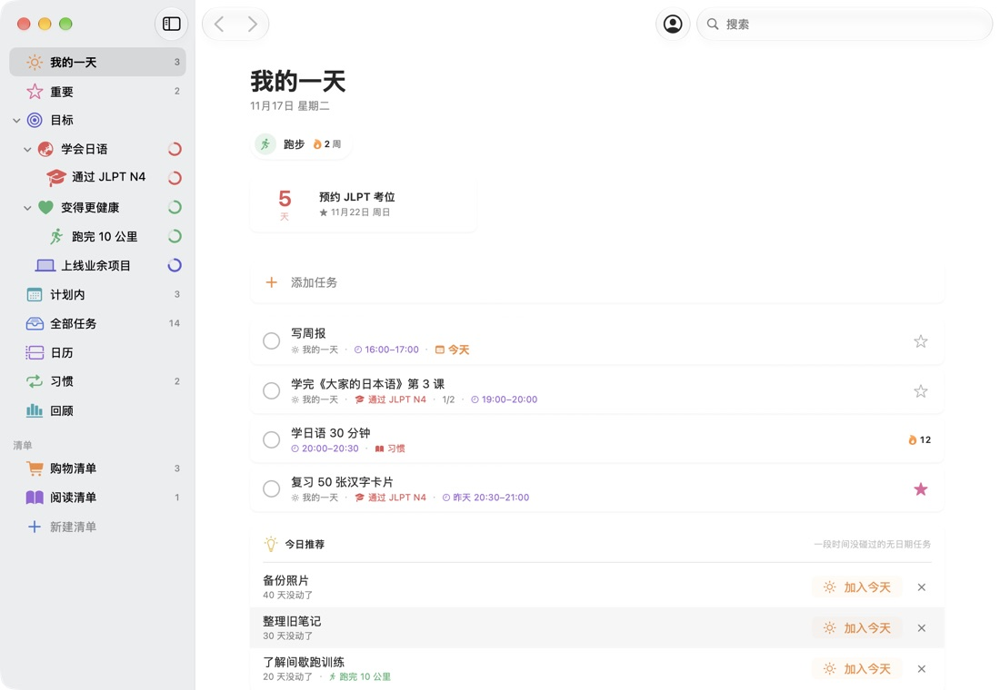

<h1 align="center">Horizon</h1>

<strong>把长期目标、每日任务和习惯放进一个安静的 Mac 计划工具，还可以选配一位 AI 秘书。</strong>

把大目标拆成小步骤，对照苹果日历安排今天，让习惯坚持下去。

  <a href="https://github.com/B0yangWong/Horizon-Releases/releases/download/v0.4.0/Horizon-0.4.0-macOS-universal.zip">下载 Mac 版</a> |
  <a href="#ai-秘书可选自带-ai">AI 秘书</a> |
  <a href="INSTALL.md">安装说明</a> |
  <a href="PRIVACY.md">隐私说明</a> |
  <a href="README.md">English</a>

---

Horizon 是一款原生 macOS 计划应用。设定长期目标，可以在下面再放短期目标，也可以不放；任务和习惯都能关联到目标，购物、作业这类日常清单也能放在旁边。“我的一天”把今天的日程、任务、有固定时间的习惯和截止倒计时放在一起，“回顾”页显示这周或这个月完成了什么。任务可以重复、可以提醒，也能在任何 app 里用快捷键打字或说话随手记下；搜索能找到任何内容，手滑了可以撤销。没有截止日期的任务也不会被遗忘：一段时间没动的事项会被温和地标出来。不需要注册 Horizon 账户、订阅或配置云端服务。

如果你愿意，还可以打开 **AI 秘书**：它能读你的任务、回答问题、写早间简报，并帮你归档随手记下的内容。Horizon 本身**不带 AI 服务**：秘书通过你 Mac 上**你自己的** Claude Code 或 Codex 工作，用你自己的 Claude 或 ChatGPT 订阅登录。它**默认关闭，需要你自己打开**；不打开秘书，其他功能照常使用。

本仓库只提供应用下载、使用文档和虚构示例截图，**不公开应用源码**。请下载 Releases 中的应用 ZIP；GitHub 自动生成的“Source code”压缩包只是本仓库的文档，不是安装包。

**0.4.0 预览版 · 最低构建目标 macOS 15 · 通用版（Apple 芯片 + Intel）。** Apple 芯片版本已在开发用 Mac 上检查；Intel 真机、旧版 macOS 和另一台全新 Mac 的首次安装尚未实测。应用为临时本地签名，没有 Apple 开发者身份签名或公证，首次打开可能被系统拦截，请先阅读[安装说明](INSTALL.md)。

## 功能

| 功能 | 可以做什么 |
| --- | --- |
| 我的一天 | 今天的日历日程排在最上面（全天日程在前，其余按时间），可以折叠成一行；下面是你挑的任务、今天到期或排了时间的任务，以及有固定时间的习惯，按时间排列。右键日程可以把它从今天移除。 |
| 截止倒计时 | “我的一天”顶部显示 30 天内最近几个重要截止日期、目标截止日和像考试或截止的日程，以及剩余天数。 |
| 回顾 | 本周或本月完成的任务数和上一期对比、每天一根带数字的柱子、按类别统计、目标进度和习惯打卡。 |
| 目标 | 长期目标下可以放短期目标，截止日期可选；进度由任务和短期目标汇总；目标总览里能看到全部目标，包括已达成和已归档的。 |
| 任务 | 步骤、可粘贴截图和附件的备注、截止日期、重要标记、所属目标、清单、类别、日历上的时间块和提醒。把任务拖到左侧栏的“我的一天”“重要”“计划内”、某个清单或目标上即可放进去。 |
| 清单与类别 | 自建清单（如“购物”“作业”），各有颜色和图标。“全部任务”可以按截止日期或按类别分组；类别和任务都能拖动排序，拖动时有一条线标出会放在哪里。 |
| 重复任务 | 每天、工作日、每周、每月、每年，或自定义（如每两周的周一和周四）。完成后自动生成下一次，时间和提醒一起带上。 |
| 提醒 | 开始前 10 或 30 分钟提醒，或自定时间；还可以选择在排程任务开始前、到期当天早上和习惯时间自动提醒。 |
| 随手记 | 全局快捷键（默认 ⌃⌥N）在任何 app 上方打开一条输入栏。输入“明天下午3点 给小王打电话 !”“每周一三五晚上8点 跑步 @运动”或“every mon and thu gym”，日期、时间、重复、重要、“#目标”和“@清单”会自动识别。还可以选择把当前 app 里选中的文字、Mail 或 Outlook 里选中的邮件、浏览器当前网页一起带进来。 |
| 语音随手记 | 第二个快捷键（默认 ⌃⌥V）把你说的话变成任务。每个快捷键都可以设为“短按”或“长按”，所以同一组按键可以两用：短按打字，长按说话。 |
| 搜索与撤销 | ⌘F 搜索任务（包括已完成的）、目标、习惯、清单和苹果日历日程。⌘Z 可以撤销删除、完成、日期和清单修改、日历拖动以及打卡。 |
| 习惯 | 每天、每周固定几天或每周 N 次，带 7 天打卡条、连续天数和可选的固定时间。 |
| 日历 | 日、周、月视图。把任务拖到时间格上排程，或拖到某天设为截止日；可以按账户分组显示或隐藏每个日历。 |
| 苹果日历同步 | 排了时间的任务、有截止日期的任务和定时习惯写入“Horizon”日历；在苹果日历里移动、改名或删除，Horizon 会跟着更新。“从日历导入”可把即将到来的日程加为任务。可选功能。 |
| 备份与更新 | 一个自动备份文件，外加最近 7 天每天一份副本，位置可选；支持 JSON 导出和导入。Horizon 每天检查一次新版本（可关闭），你点一下就会装上经过签名校验的更新。 |
| 使用细节 | 中文或英文界面（可在设置里切换），日期显示为“后天”这样的说法或具体日期，文字大小 85%–150%，任务列表可用键盘操作，栏目间返回/前进，左侧栏可拖动排序。 |

## AI 秘书（可选，自带 AI）

Horizon 没有自己的 AI 服务，也不用 API 密钥。秘书使用下面任意一个命令行工具，需要**你自己**在 Mac 上安装并登录：

| 工具 | 使用的账户 | 安装（在“终端”里） | 登录 |
| --- | --- | --- | --- |
| [Claude Code](https://github.com/anthropics/claude-code) | 包含 Claude Code 的 Claude 订阅 | `brew install --cask claude-code` | `claude auth login` |
| [Codex](https://github.com/openai/codex) | 包含 Codex 的 ChatGPT 订阅 | `brew install --cask codex` | `codex login` |

装好后，点工具栏上的人像图标打开秘书，或进入**设置 → 秘书**，打开开关并选择工具和模型。Horizon 会显示每个工具是否已安装、是否已登录。用量计入你自己订阅的额度；Horizon 不收费，也接触不到你的登录信息。

打开后它可以：

- **聊天：**问它关于任务和日程的问题；回答以卡片呈现，附带按钮（加入我的一天、设提醒、移到某个清单……），你不点就什么都不改。可以发图片。
- **读懂任务：**在任务里点“让秘书看看”，它会读备注和附件，给出重要程度、截止要求、下一步，需要时再列步骤。
- **在你设的范围内主动说话：**早间简报、快到时间的提醒、偶尔问一个问题。频率（从不到每天最多 6 条）、免打扰时段和语气都在设置里。
- **归档随手记：**你记下的内容会先立即存为任务，再由秘书决定是否改放进某个清单、目标或记忆。
- **向你学习：**每条消息下面可以点赞或点踩；每三天它会重写一份简短的工作守则，你可以查看和修改。

**哪些内容会离开你的 Mac：**秘书打开期间，每次请求会通过你选的工具，把这项工作需要的内容发送给 Anthropic（Claude Code）或 OpenAI（Codex）：相关任务及其备注、步骤、附件文字或图片；你的清单、目标、类别和习惯；苹果日历日程（如果已连接，范围是过去一年到未来两年）；你写的“关于我”；秘书的记忆；以及最近的聊天记录。这些数据适用对方自己的条款和隐私政策。Horizon 调用工具时会关闭它自带的工具、插件（MCP 服务器）和会话保存。随时关闭秘书，就不会再发送任何内容。详见[隐私说明](PRIVACY.md)。

另外，**设置 → 秘书 → 在 Claude 和 Codex 中使用 Horizon** 可以把 Horizon 加到你自己的 Claude Code 或 Codex 里，这样*你*在终端里和它们聊天时，它们能查看你的任务并按你的要求修改。

## 截图预览

截图使用内存中的虚构目标、任务和习惯，并关闭了苹果日历，不含个人资料；全新安装不会带有示例内容。“我的一天”、回顾页、秘书面板和中文截图来自 0.4.0，其余来自 0.3.0（这些页面外观相同）。

英文界面、任务面板、搜索、目标、月历和习惯

## 安装与打开

1. 从 [0.4.0 版本页](https://github.com/B0yangWong/Horizon-Releases/releases/tag/v0.4.0)下载 [Horizon-0.4.0-macOS-universal.zip](https://github.com/B0yangWong/Horizon-Releases/releases/download/v0.4.0/Horizon-0.4.0-macOS-universal.zip)。
2. 解压后把 `Horizon.app` 拖进“应用程序”。应用内更新需要它放在那里。
3. 打开应用。如果 macOS 提示无法验证开发者，请先确认是否信任这个下载，只按 [Apple 官方说明](https://support.apple.com/zh-cn/102445)手动允许。如果提示“将损害你的电脑”或“已损坏”，请停止并反馈。不要关闭系统安全检查，也不要运行移除隔离标记的命令。
4. Horizon 会询问一次能否发送通知（用于提醒）。苹果日历、麦克风和语音识别、读取其他 app 的选中内容，都只在你第一次用到时才询问，全部可选。

**从 0.3.0 或更早版本升级：**退出 Horizon，替换“应用程序”里的旧版本再打开。0.4.0 第一次启动时会把资料从旧的沙盒目录复制出来，原目录保持不动，作为备份。从 0.4.0 起，点左侧栏底部的“更新到 …”或“设置 → 通用”里的“安装 … 并重新打开”即可自动更新。

发布页附有 `SHA256SUMS.txt`，用于核对下载文件是否一致；它不能证明发布者身份，也不代表 Apple 认可。详见[安装说明](INSTALL.md)。

## 常用操作

| 操作 | 快捷键 |
| --- | --- |
| 在任何 app 里随手记 | `Control + Option + N`（可改，可设短按或长按） |
| 在任何 app 里语音随手记 | `Control + Option + V`（可改，可设短按或长按） |
| 跳到当前列表的“添加任务” | `Command + N` |
| 新建目标 / 新建清单 | `Command + Shift + N` / `Command + Shift + L` |
| 搜索 | `Command + F` |
| 撤销 / 重做 | `Command + Z` / `Command + Shift + Z` |
| 栏目间返回 / 前进 | `Command + [` / `Command + ]` |
| 按当前顺序切换左侧栏目 | `Command + 1` … `Command + 8` |
| 选中任务：完成 / 我的一天 / 重要 | `Command + D` / `Command + T` / `Command + I` |
| 删除选中任务 | `Command + Delete` |
| 放大 / 缩小 / 默认文字 | `Command + +` / `Command + −` / `Command + 0` |
| 关闭任务面板 | `Escape`，或点空白处 |
| 关闭秘书 | 点空白处，或点它的关闭按钮 |
| 设置 | `Command + ,` |

添加任务时，日期（“明天”“周五”“这周末”“11/20”）、时间（“下午3点”“3pm”）、时长（“1h”“半小时”）、重复（“每周一三五”“工作日”“every mon and wed”）、`!`（重要）、`#` 加目标名的一部分、`@` 加清单名的一部分都会被识别，并在按回车前以标签显示。

## 资料留在你的 Mac 上

目标、任务、清单、习惯、附件、秘书的聊天和记忆以及备份都保存在本机 `~/Library/Application Support/Horizon/`，设置保存在 `~/Library/Preferences/app.horizon.mac.plist`。没有 Horizon 账户、广告、统计上传或云同步。Horizon 自己只会在两种情况下联网：每天向 GitHub 检查一次更新（可关闭），以及下载你选择安装的更新。资料只会经由你打开的功能离开 Mac：AI 秘书（通过你自己的工具发给 Anthropic 或 OpenAI）、苹果日历（像其他日历一样由 Apple 或日历服务商同步），以及语音随手记在你的语言无法在本机识别时（使用 Apple 的语音识别服务）。详见[隐私说明](PRIVACY.md)。

## 当前限制与反馈

Horizon 是供本机使用的预览版，没有 iPhone 版、多台 Mac 之间的同步、苹果“提醒事项”集成或协作功能。秘书需要 Horizon 在运行才能主动给你发消息（可开启“登录时打开 Horizon”）；它的水平取决于你选的模型，也可能出错：它只提建议，你不点就不改任何东西，唯一的例外是在你开启该选项时归档随手记。日期识别基于简单规则，遇到少见说法可能识别错，所以会在添加前先显示出来。已检查和未检查的范围见[验证说明](VALIDATION.md)。

[报告问题或提建议](https://github.com/B0yangWong/Horizon-Releases/issues/new/choose)时，请写明应用版本、macOS 版本和用虚构内容复现的步骤。Issue 是公开的：不要附上真实任务、日历详情、备份文件、聊天记录或含个人信息的截图。报告安全漏洞前请先阅读[安全说明](SECURITY.md)。

应用可免费下载并在自己的 Mac 上运行。本仓库不授予应用或图标的开源许可。详见[使用范围](USAGE.md)和[更新记录](CHANGELOG.md)。
